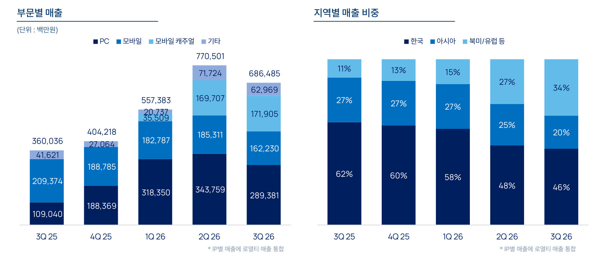
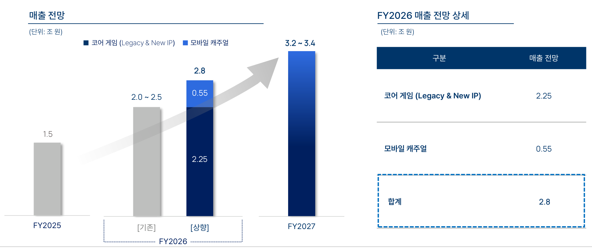

| 기준일 | 분기 (발표일정) | 현재주가 (시총) | 밸류에이션 요약 |
| :---: | :---: | :---: | :---: |
| 26/11/11 | 3Q26 (11/11 장중 공시) | 209,000원 · 당일 -2.1% (4조 5,027억원) | 실적 반영 NTM P/E 8.5x (PEG 0.73x) · FY27E P/E 8.3x |

| 단위: 억원 | FY2022 | FY2023 | FY2024 | FY2025 | FY2026E | FY2027E | FY2028E |
| :--- | :---: | :---: | :---: | :---: | :---: | :---: | :---: |
| 매출액 | 25,718 | 17,798 | 15,781 | 15,069 | 28,200 | 33,000 | 35,200 |
| 매출 성장률 YoY (%) | - | -30.8% | -11.3% | -4.5% | +87.1% | +17.0% | +6.7% |
| 영업비용 | 20,128 | 16,425 | 16,873 | 14,908 | 22,550 | 26,550 | 27,950 |
| 영업이익 | 5,590 | 1,373 | -1,092 | 161 | 5,650 | 6,450 | 7,250 |
| 영업이익 YoY (%) | - | -75.4% | 적자전환 | 흑자전환 | N/M | +14.2% | +12.4% |
| 영업이익률 (%) | 21.7% | 7.7% | -6.9% | 1.1% | 20.0% | 19.5% | 20.6% |
| 당기순이익 (지배주주) | 4,357 | 2,121 | 942 | 3,467 | 4,150 | 5,450 | 5,966 |
| 희석 EPS (원) | 21,456 | 10,446 | 4,728 | 17,876 | 19,263 | 25,297 | 27,692 |
| 희석주식수 (가중평균, 천주) | 20,307 | 20,308 | 19,927 | 19,393 | 21,544 | 21,544 | 21,544 |
| PER (희석 기준, 배) | 20.9x | 23.0x | 38.7x | 11.3x | 10.8x | 8.3x | 7.5x |

| 단위: 억원 | 3Q25 | 4Q25 | 1Q26 | 2Q26 | 3Q26 | 4Q26E | 1Q27E |
| :--- | :---: | :---: | :---: | :---: | :---: | :---: | :---: |
| 매출액 | 3,600 | 4,042 | 5,574 | 7,705 | 6,865 | 8,056 | 7,950 |
| 매출 성장률 YoY (%) | -10.4% | -1.3% | +54.7% | +101.5% | +90.7% | +99.3% | +42.6% |
| 매출 성장률 QoQ (%) | -5.9% | +12.3% | +37.9% | +38.2% | -10.9% | +17.3% | -1.3% |
| 영업비용 | 3,675 | 4,010 | 4,441 | 5,966 | 5,669 | 6,474 | 6,440 |
| 영업이익 | -75 | 32 | 1,133 | 1,739 | 1,196 | 1,582 | 1,510 |
| 영업이익 YoY (%) | 적자지속 | 흑자전환 | N/M | N/M | 흑자전환 | N/M | +33.3% |
| 영업이익률 (%) | -2.1% | 0.8% | 20.3% | 22.6% | 17.4% | 19.6% | 19.0% |
| 당기순이익 (지배주주) | 3,467 | -24 | 1,488 | 1,246 | 159 | 1,257 | 1,260 |
| 희석 EPS (원) | 17,878 | -110 | 7,672 | 6,407 | 737 | 5,835 | 5,848 |
| 희석주식수 (가중평균, 천주) | 19,392 | 21,544 | 19,393 | 19,454 | 21,544 | 21,544 | 21,544 |

## 01. 핵심 실적 요약

### 1. 주가 흐름 및 시장 반응 : 아이온2 글로벌 출시 직후 셀온 조정 끝에 순이익 하회 관망세로 당일 -2.1% 마감
- 8월 11일 2분기 어닝 서프라이즈로 255,500원(+4.9%)에 반등했으나 다음 날 TL 글로벌 이관 공시 이후 PC 트래픽 둔화 우려가 겹치며 조정받음.
- 10월 초 아이온2 글로벌 출시 기대감에 241,000원까지 회복했으나 출시 후 스팀 동접 반감 우려로 10월 6일 -7.1% 셀온이 출회해 11월 3일 195,300원까지 하락함.
- 11월 11일 영업이익 상회(+15.8%)와 가이던스 상향에도 외환·금융평가손실에 따른 순이익 부진과 16시 컨콜 대기 관망세로 209,000원(-2.1%, KRX 전일비 -0.9%)에 마감함.

### 2. 실적 및 가이던스 요약 : 영업이익 컨센서스 +15.8% 상회 및 2026년 2.8조·2027년 3.2 - 3.4조 가이던스 상향
- 3분기 매출액은 6,865억원(+90.7% YoY · -10.9% QoQ)으로 리니지 클래식 연착륙(1,587억원)과 모바일 캐주얼 성장(1,719억원)에 힘입어 컨센서스에 부합함.
- 인건비 및 수수료 절감으로 영업이익은 1,196억원(OPM 17.4%)을 기록해 컨센서스를 15.8% 상회했으나, 영업외 외환·금융평가손실(-824억원)로 지배순이익은 159억원에 그침.
- 회사는 공정공시를 통해 2026년 매출 전망을 기존 2.0 - 2.5조원에서 2.8조원으로 상향하고, 신작 10종을 반영한 2027년 매출 가이던스 3.2 - 3.4조원을 신규 제시함.

| 단위: 억원 (EPS는 원) | 3Q26 실제 | 컨센서스  | vs 컨센  |   YoY   |  QoQ   |
| :-------------- | :-----: | :---: | :----: | :-----: | :----: |
| 매출액             |  6,865  | 7,037 | -2.4%  | +90.7%  | -10.9% |
| PC 온라인 게임       |  2,894  |   -   |   -    | +165.4% | -15.8% |
| 모바일 게임          |  1,622  |   -   |   -    | -22.5%  | -12.5% |
| 모바일 캐주얼         |  1,719  |   -   |   -    |  신규편입   | +1.3%  |
| 영업비용            |  5,669  |   -   |   -    | +54.2%  | -5.0%  |
| 영업이익 (K-IFRS)   |  1,196  | 1,033 | +15.8% |  흑자전환   | -31.2% |
| 영업이익률           |  17.4%  | 14.7% | +2.7%p | +19.5%p | -5.1%p |
| 당기순이익 (지배주주)    |   159   |  806  | -80.3% | -95.4%  | -87.3% |
| 희석 EPS (원)      |   737   | 3,742 | -80.3% | -95.9%  | -88.5% |

- 표 기준 : K-IFRS 연결 잠정실적 및 실적 발표 직전 시장 컨센서스 기준선(총발행주식수 21,544천주 환산 EPS)이며, 부문별 매출은 로열티 매출을 각 IP에 통합한 신규 기준임.

## 02. 분기 매출 추이 및 사업부별 실적

<svg xmlns="http://www.w3.org/2000/svg" viewBox="0 0 680 240" width="100%" role="img" aria-label="분기 매출 추이 (억원)" style="display:block;width:100%;max-width:100%;height:auto;margin:0.5em auto;font-family:inherit;font-variant-numeric:tabular-nums"><text x="4.0" y="14.0" text-anchor="start" style="fill:var(--gray,var(--text-muted,#8c877c));font-size:12px">매출 (억원)</text><line x1="64" x2="664" y1="210.0" y2="210.0" style="stroke:var(--lightgray,var(--background-modifier-border,#e9e6dd));stroke-width:1"/><text x="56.0" y="214.0" text-anchor="end" style="fill:var(--gray,var(--text-muted,#8c877c));font-size:12px">0</text><line x1="64" x2="664" y1="173.6" y2="173.6" style="stroke:var(--lightgray,var(--background-modifier-border,#e9e6dd));stroke-width:1"/><text x="56.0" y="177.6" text-anchor="end" style="fill:var(--gray,var(--text-muted,#8c877c));font-size:12px">2,000</text><line x1="64" x2="664" y1="137.2" y2="137.2" style="stroke:var(--lightgray,var(--background-modifier-border,#e9e6dd));stroke-width:1"/><text x="56.0" y="141.2" text-anchor="end" style="fill:var(--gray,var(--text-muted,#8c877c));font-size:12px">4,000</text><line x1="64" x2="664" y1="100.8" y2="100.8" style="stroke:var(--lightgray,var(--background-modifier-border,#e9e6dd));stroke-width:1"/><text x="56.0" y="104.8" text-anchor="end" style="fill:var(--gray,var(--text-muted,#8c877c));font-size:12px">6,000</text><line x1="64" x2="664" y1="64.4" y2="64.4" style="stroke:var(--lightgray,var(--background-modifier-border,#e9e6dd));stroke-width:1"/><text x="56.0" y="68.4" text-anchor="end" style="fill:var(--gray,var(--text-muted,#8c877c));font-size:12px">8,000</text><line x1="64" x2="664" y1="28.0" y2="28.0" style="stroke:var(--lightgray,var(--background-modifier-border,#e9e6dd));stroke-width:1"/><text x="56.0" y="32.0" text-anchor="end" style="fill:var(--gray,var(--text-muted,#8c877c));font-size:12px">10,000</text><rect x="492.6" y="28" width="171.4" height="182" style="fill:var(--lightgray,var(--background-modifier-border,#e9e6dd));fill-opacity:0.45"/><text x="497.6" y="21.0" text-anchor="start" style="fill:var(--gray,var(--text-muted,#8c877c));font-size:12px">추정</text><text x="106.9" y="228.0" text-anchor="middle" style="fill:var(--gray,var(--text-muted,#8c877c));font-size:12px">3Q25</text><text x="192.6" y="228.0" text-anchor="middle" style="fill:var(--gray,var(--text-muted,#8c877c));font-size:12px">4Q25</text><text x="278.3" y="228.0" text-anchor="middle" style="fill:var(--gray,var(--text-muted,#8c877c));font-size:12px">1Q26</text><text x="364.0" y="228.0" text-anchor="middle" style="fill:var(--gray,var(--text-muted,#8c877c));font-size:12px">2Q26</text><text x="449.7" y="228.0" text-anchor="middle" style="fill:var(--gray,var(--text-muted,#8c877c));font-size:12px">3Q26</text><text x="535.4" y="228.0" text-anchor="middle" style="fill:var(--gray,var(--text-muted,#8c877c));font-size:12px">4Q26E</text><text x="621.1" y="228.0" text-anchor="middle" style="fill:var(--gray,var(--text-muted,#8c877c));font-size:12px">1Q27E</text><path d="M90.9,210.0 L90.9,148.5 Q90.9,144.5 94.9,144.5 L118.9,144.5 Q122.9,144.5 122.9,148.5 L122.9,210.0 Z" style="fill:#3987e5;fill-opacity:1"><title>3Q25 매출 3,600 억원 (YoY -10.4%)</title></path><text x="106.9" y="139.5" text-anchor="middle" style="fill:var(--darkgray,var(--text-normal,#4a463e));font-size:11px">3,600</text><path d="M176.6,210.0 L176.6,140.4 Q176.6,136.4 180.6,136.4 L204.6,136.4 Q208.6,136.4 208.6,140.4 L208.6,210.0 Z" style="fill:#3987e5;fill-opacity:1"><title>4Q25 매출 4,042 억원 (YoY -1.3%)</title></path><text x="192.6" y="131.4" text-anchor="middle" style="fill:var(--darkgray,var(--text-normal,#4a463e));font-size:11px">4,042</text><path d="M262.3,210.0 L262.3,112.6 Q262.3,108.6 266.3,108.6 L290.3,108.6 Q294.3,108.6 294.3,112.6 L294.3,210.0 Z" style="fill:#3987e5;fill-opacity:1"><title>1Q26 매출 5,574 억원 (YoY +54.7%)</title></path><text x="278.3" y="103.6" text-anchor="middle" style="fill:var(--darkgray,var(--text-normal,#4a463e));font-size:11px">5,574</text><path d="M348.0,210.0 L348.0,73.8 Q348.0,69.8 352.0,69.8 L376.0,69.8 Q380.0,69.8 380.0,73.8 L380.0,210.0 Z" style="fill:#3987e5;fill-opacity:1"><title>2Q26 매출 7,705 억원 (YoY +101.5%)</title></path><text x="364.0" y="64.8" text-anchor="middle" style="fill:var(--darkgray,var(--text-normal,#4a463e));font-size:11px">7,705</text><path d="M433.7,210.0 L433.7,89.1 Q433.7,85.1 437.7,85.1 L461.7,85.1 Q465.7,85.1 465.7,89.1 L465.7,210.0 Z" style="fill:#3987e5;fill-opacity:1"><title>3Q26 매출 6,865 억원 (YoY +90.7%)</title></path><text x="449.7" y="80.1" text-anchor="middle" style="fill:var(--darkgray,var(--text-normal,#4a463e));font-size:11px">6,865</text><path d="M519.4,210.0 L519.4,67.4 Q519.4,63.4 523.4,63.4 L547.4,63.4 Q551.4,63.4 551.4,67.4 L551.4,210.0 Z" style="fill:#3987e5;fill-opacity:0.42"><title>4Q26E 매출 8,056 억원 (YoY +99.3%)</title></path><text x="535.4" y="58.4" text-anchor="middle" style="fill:var(--darkgray,var(--text-normal,#4a463e));font-size:11px">8,056</text><path d="M605.1,210.0 L605.1,69.3 Q605.1,65.3 609.1,65.3 L633.1,65.3 Q637.1,65.3 637.1,69.3 L637.1,210.0 Z" style="fill:#3987e5;fill-opacity:0.42"><title>1Q27E 매출 7,950 억원 (YoY +42.6%)</title></path><text x="621.1" y="60.3" text-anchor="middle" style="fill:var(--darkgray,var(--text-normal,#4a463e));font-size:11px">7,950</text><line x1="64" x2="664" y1="210" y2="210" style="stroke:var(--gray,var(--text-muted,#8c877c));stroke-width:1"/></svg>

| 단위: 억원 | 3Q25 | 4Q25 | 1Q26 | 2Q26 | 3Q26 | 4Q26E | 1Q27E |
| :--- | :---: | :---: | :---: | :---: | :---: | :---: | :---: |
| 매출 | 3,600 | 4,042 | 5,574 | 7,705 | 6,865 | 8,056 | 7,950 |
| YoY | -10.4% | -1.3% | +54.7% | +101.5% | +90.7% | +99.3% | +42.6% |
| QoQ | -5.9% | +12.3% | +37.9% | +38.2% | -10.9% | +17.3% | -1.3% |

### 1. 사업부별 실적 및 주요 지표

| 단위: 억원 | 1Q25 | 2Q25 | 3Q25 | 4Q25 | 1Q26 | 2Q26 | 3Q26 |
| :--- | :---: | :---: | :---: | :---: | :---: | :---: | :---: |
| PC 온라인 게임 | 1,027 | 1,087 | 1,090 | 1,884 | 3,184 | 3,438 | 2,894 |
| PC 리니지 (클래식 포함) | 223 | 223 | 274 | 267 | 998 | 2,047 | 1,756 |
| PC 아이온2 | - | - | - | 774 | 1,368 | 719 | 526 |
| 기타 PC 4종 | 804 | 864 | 816 | 843 | 818 | 672 | 612 |
| 모바일 게임 | 2,135 | 2,235 | 2,094 | 1,888 | 1,828 | 1,853 | 1,622 |
| 리니지M | 1,127 | 1,211 | 1,188 | 1,045 | 1,128 | 1,173 | 1,030 |
| 리니지2M · 리니지W | 1,008 | 1,024 | 906 | 843 | 700 | 680 | 592 |
| 모바일 캐주얼 | - | - | - | - | 355 | 1,697 | 1,719 |
| 기타 매출 | 441 | 502 | 416 | 271 | 207 | 717 | 630 |
| 해외 매출 비중 (%) | 37.3% | 35.0% | 38.0% | 40.0% | 42.0% | 52.0% | 54.0% |

- PC 온라인 게임 (매출 2,894억원 · 비중 42.2% · +165.4% YoY · -15.8% QoQ)
  - 리니지 클래식이 2분기 고점(1,855억원) 대비 14.4% 감소한 1,587억원을 기록했으며, 견조한 결제 유저 잔존율로 출시 8개월 누적 매출 4,530억원에 안착함.
  - 국내·대만 아이온2는 526억원(출시 10개월 누적 3,386억원)을 기록했고, 9월 30일 출시 후 42일간 1,103억원을 달성한 글로벌 결제액은 3분기에 거의 반영되지 않아 4분기부터 본격 기여함.
- 모바일 캐주얼 및 글로벌 믹스 (캐주얼 매출 1,719억원 · 비중 25.0% · +1.3% QoQ)
  - 북미·유럽 리워드 플랫폼 JustPlay의 월간 이용자 증가와 광고주 수요 호조, 자회사 Veroplay 산하 무빙아이 연결 반영으로 분기 매출 비중 25%(9개월 누적 3,771억원)까지 상승함.
  - 북미·유럽 매출 비중이 2분기 27%에서 3분기 34%로 뛰면서 해외 매출 비중이 54%(한국 46% · 아시아 20%)로 5개 분기 연속 높아졌고, 탕탕특공대 차기작 글로벌 퍼블리싱 판권도 추가 확보함.
- 모바일 레거시 게임 (매출 1,622억원 · 비중 23.6% · -22.5% YoY · -12.5% QoQ)
  - 대형 업데이트 부재 영향으로 리니지M이 1,030억원(-12.2% QoQ), 리니지2M이 356억원(-4.2% QoQ), 리니지W가 236억원(-23.3% QoQ)으로 일제히 감소하며 기존 모바일 하향 추세가 이어짐.

### 2. 주요 경쟁사 사업부 분기 추이

| 단위: 억원 | 1Q25 | 2Q25 | 3Q25 | 4Q25 | 1Q26 | 2Q26 | 3Q26 |
| :--- | :---: | :---: | :---: | :---: | :---: | :---: | :---: |
| NC 매출 | 3,603 | 3,824 | 3,600 | 4,042 | 5,574 | 7,705 | 6,865 |
| NC 영업이익 (OPM) | 52 (1.4%) | 151 (3.9%) | -75 (-2.1%) | 32 (0.8%) | 1,133 (20.3%) | 1,739 (22.6%) | 1,196 (17.4%) |
| 크래프톤 매출 | 8,742 | 6,620 | 8,706 | 9,197 | 13,714 | 12,902 | 9,714 |
| 크래프톤 영업이익 (OPM) | 4,573 (52.3%) | 2,461 (37.2%) | 3,486 (40.0%) | 24 (0.3%) | 5,616 (41.0%) | 4,109 (31.8%) | 2,250 (23.2%) |
| 넷마블 매출 | 6,239 | 7,176 | 6,960 | 7,976 | 6,517 | 7,492 | 6,347 |
| 넷마블 영업이익 (OPM) | 497 (8.0%) | 1,011 (14.1%) | 909 (13.1%) | 1,108 (13.9%) | 531 (8.1%) | 801 (10.7%) | 504 (7.9%) |
| 시프트업 매출 | 422 | 1,124 | 755 | 644 | 473 | 557 | 462 |
| 시프트업 영업이익 (OPM) | 263 (62.2%) | 682 (60.7%) | 495 (65.6%) | 374 (58.1%) | 215 (45.5%) | 281 (50.4%) | 207 (44.8%) |

- 국내 주요 상장 게임사 중 유일한 전년 동기 대비 영업 증익 및 외형 고성장 달성
  - 크래프톤(3분기 영업이익 -35.5% YoY), 넷마블(-44.6% YoY), 시프트업(-58.2% YoY)이 주력 IP 기저 부담과 신작 공백으로 일제히 큰 폭의 감익을 기록한 것과 달리 NC만 영업 흑자전환에 성공함.
  - PC 정액제 기반 리니지 클래식과 글로벌 캐주얼 애드테크 결합으로 분기 영업이익률 17.4%를 기록해 넷마블(7.9%)과의 마진 격차를 9.5%p로 벌리며 업종 내 이익 모멘텀 차별화를 확인함.
- 3분기 업종 전반의 기말 환율 변동에 따른 비영업 외화환산손실 공통 발생
  - 해외 현금·외화자산 비중이 높은 크래프톤(지배순손실 -641억원 적자전환)과 시프트업(순손실 -255억원 적자전환) 역시 3분기에 대규모 영업외 외환손실을 인식해 순이익 하회가 개별 기업 펀더멘털 훼손이 아닌 업종 공통 환율 효과임을 방증함.

## 03. 수익성 및 마진 추이

<svg xmlns="http://www.w3.org/2000/svg" viewBox="0 0 680 240" width="100%" role="img" aria-label="마진율 추이 (%)" style="display:block;width:100%;max-width:100%;height:auto;margin:0.5em auto;font-family:inherit;font-variant-numeric:tabular-nums"><line x1="56" x2="604" y1="206.0" y2="206.0" style="stroke:var(--lightgray,var(--background-modifier-border,#e9e6dd));stroke-width:1"/><text x="50.0" y="210.0" text-anchor="end" style="fill:var(--gray,var(--text-muted,#8c877c));font-size:12px">-10%</text><line x1="56" x2="604" y1="162.0" y2="162.0" style="stroke:var(--lightgray,var(--background-modifier-border,#e9e6dd));stroke-width:1"/><text x="50.0" y="166.0" text-anchor="end" style="fill:var(--gray,var(--text-muted,#8c877c));font-size:12px">0%</text><line x1="56" x2="604" y1="118.0" y2="118.0" style="stroke:var(--lightgray,var(--background-modifier-border,#e9e6dd));stroke-width:1"/><text x="50.0" y="122.0" text-anchor="end" style="fill:var(--gray,var(--text-muted,#8c877c));font-size:12px">10%</text><line x1="56" x2="604" y1="74.0" y2="74.0" style="stroke:var(--lightgray,var(--background-modifier-border,#e9e6dd));stroke-width:1"/><text x="50.0" y="78.0" text-anchor="end" style="fill:var(--gray,var(--text-muted,#8c877c));font-size:12px">20%</text><line x1="56" x2="604" y1="30.0" y2="30.0" style="stroke:var(--lightgray,var(--background-modifier-border,#e9e6dd));stroke-width:1"/><text x="50.0" y="34.0" text-anchor="end" style="fill:var(--gray,var(--text-muted,#8c877c));font-size:12px">30%</text><rect x="447.4" y="30" width="156.6" height="176" style="fill:var(--lightgray,var(--background-modifier-border,#e9e6dd));fill-opacity:0.45"/><text x="452.4" y="23.0" text-anchor="start" style="fill:var(--gray,var(--text-muted,#8c877c));font-size:12px">추정</text><text x="95.1" y="224.0" text-anchor="middle" style="fill:var(--gray,var(--text-muted,#8c877c));font-size:12px">3Q25</text><text x="173.4" y="224.0" text-anchor="middle" style="fill:var(--gray,var(--text-muted,#8c877c));font-size:12px">4Q25</text><text x="251.7" y="224.0" text-anchor="middle" style="fill:var(--gray,var(--text-muted,#8c877c));font-size:12px">1Q26</text><text x="330.0" y="224.0" text-anchor="middle" style="fill:var(--gray,var(--text-muted,#8c877c));font-size:12px">2Q26</text><text x="408.3" y="224.0" text-anchor="middle" style="fill:var(--gray,var(--text-muted,#8c877c));font-size:12px">3Q26</text><text x="486.6" y="224.0" text-anchor="middle" style="fill:var(--gray,var(--text-muted,#8c877c));font-size:12px">4Q26E</text><text x="564.9" y="224.0" text-anchor="middle" style="fill:var(--gray,var(--text-muted,#8c877c));font-size:12px">1Q27E</text><line x1="56" x2="70" y1="13" y2="13" style="stroke:#3987e5;stroke-width:2.5;stroke-linecap:round"/><text x="75.0" y="17.0" text-anchor="start" style="fill:var(--darkgray,var(--text-normal,#4a463e));font-size:12px">EBITDA 마진</text><line x1="152" x2="166" y1="13" y2="13" style="stroke:#d95926;stroke-width:2.5;stroke-linecap:round"/><text x="171.0" y="17.0" text-anchor="start" style="fill:var(--darkgray,var(--text-normal,#4a463e));font-size:12px">OPM</text><polyline points="95.1,144.8 173.4,134.3 251.7,54.6 330.0,48.5 408.3,68.7" style="fill:none;stroke:#3987e5;stroke-width:2;stroke-linejoin:round;stroke-linecap:round"/><polyline points="408.3,68.7 486.6,60.8 564.9,63.4" style="fill:none;stroke:#3987e5;stroke-width:2;stroke-dasharray:5 4;stroke-linecap:round"/><circle cx="95.1" cy="144.8" r="4" style="fill:#3987e5;stroke:var(--light,var(--background-primary,#faf9f5));stroke-width:2"><title>3Q25 EBITDA 마진 3.9%</title></circle><circle cx="173.4" cy="134.3" r="4" style="fill:#3987e5;stroke:var(--light,var(--background-primary,#faf9f5));stroke-width:2"><title>4Q25 EBITDA 마진 6.3%</title></circle><circle cx="251.7" cy="54.6" r="4" style="fill:#3987e5;stroke:var(--light,var(--background-primary,#faf9f5));stroke-width:2"><title>1Q26 EBITDA 마진 24.4%</title></circle><circle cx="330.0" cy="48.5" r="4" style="fill:#3987e5;stroke:var(--light,var(--background-primary,#faf9f5));stroke-width:2"><title>2Q26 EBITDA 마진 25.8%</title></circle><circle cx="408.3" cy="68.7" r="4" style="fill:#3987e5;stroke:var(--light,var(--background-primary,#faf9f5));stroke-width:2"><title>3Q26 EBITDA 마진 21.2%</title></circle><circle cx="486.6" cy="60.8" r="4" style="fill:#3987e5;stroke:var(--light,var(--background-primary,#faf9f5));stroke-width:2"><title>4Q26E EBITDA 마진 23.0%</title></circle><circle cx="564.9" cy="63.4" r="4" style="fill:#3987e5;stroke:var(--light,var(--background-primary,#faf9f5));stroke-width:2"><title>1Q27E EBITDA 마진 22.4%</title></circle><text x="573.9" y="67.4" text-anchor="start" style="fill:var(--darkgray,var(--text-normal,#4a463e));font-size:12.5px">마진 22.4%</text><text x="408.3" y="87.7" text-anchor="middle" style="fill:var(--darkgray,var(--text-normal,#4a463e));font-size:12.5px">21.2%</text><polyline points="95.1,171.2 173.4,158.5 251.7,72.7 330.0,62.6 408.3,85.4" style="fill:none;stroke:#d95926;stroke-width:2;stroke-linejoin:round;stroke-linecap:round"/><polyline points="408.3,85.4 486.6,75.8 564.9,78.4" style="fill:none;stroke:#d95926;stroke-width:2;stroke-dasharray:5 4;stroke-linecap:round"/><circle cx="95.1" cy="171.2" r="4" style="fill:#d95926;stroke:var(--light,var(--background-primary,#faf9f5));stroke-width:2"><title>3Q25 OPM -2.1%</title></circle><circle cx="173.4" cy="158.5" r="4" style="fill:#d95926;stroke:var(--light,var(--background-primary,#faf9f5));stroke-width:2"><title>4Q25 OPM 0.8%</title></circle><circle cx="251.7" cy="72.7" r="4" style="fill:#d95926;stroke:var(--light,var(--background-primary,#faf9f5));stroke-width:2"><title>1Q26 OPM 20.3%</title></circle><circle cx="330.0" cy="62.6" r="4" style="fill:#d95926;stroke:var(--light,var(--background-primary,#faf9f5));stroke-width:2"><title>2Q26 OPM 22.6%</title></circle><circle cx="408.3" cy="85.4" r="4" style="fill:#d95926;stroke:var(--light,var(--background-primary,#faf9f5));stroke-width:2"><title>3Q26 OPM 17.4%</title></circle><circle cx="486.6" cy="75.8" r="4" style="fill:#d95926;stroke:var(--light,var(--background-primary,#faf9f5));stroke-width:2"><title>4Q26E OPM 19.6%</title></circle><circle cx="564.9" cy="78.4" r="4" style="fill:#d95926;stroke:var(--light,var(--background-primary,#faf9f5));stroke-width:2"><title>1Q27E OPM 19.0%</title></circle><text x="573.9" y="82.4" text-anchor="start" style="fill:var(--darkgray,var(--text-normal,#4a463e));font-size:12.5px">OPM 19.0%</text><text x="408.3" y="104.4" text-anchor="middle" style="fill:var(--darkgray,var(--text-normal,#4a463e));font-size:12.5px">17.4%</text></svg>

| 단위: 억원 | 3Q25 | 4Q25 | 1Q26 | 2Q26 | 3Q26 | 4Q26E | 1Q27E |
| :--- | :---: | :---: | :---: | :---: | :---: | :---: | :---: |
| 영업비용 | 3,675 | 4,010 | 4,441 | 5,966 | 5,669 | 6,474 | 6,440 |
| EBITDA | 139 | 255 | 1,362 | 1,990 | 1,458 | 1,850 | 1,780 |
| EBITDA 마진 | 3.9% | 6.3% | 24.4% | 25.8% | 21.2% | 23.0% | 22.4% |
| 영업이익 (K-IFRS) | -75 | 32 | 1,133 | 1,739 | 1,196 | 1,582 | 1,510 |
| OPM | -2.1% | 0.8% | 20.3% | 22.6% | 17.4% | 19.6% | 19.0% |
| Cons. OPM | - | - | - | - | 14.7% | 20.0% | 18.7% |

- 표 기준 : K-IFRS 연결 단일 영업비용 구조 기준이며, EBITDA는 영업이익에 감가상각비 및 무형자산상각비(3Q26 261억원)를 가산한 수치이고 Cons. OPM은 실적 발표 직전 시장 컨센서스 영업이익률임.

### 1. 수익성 변동 요인 및 재무구조 점검
- 영업비용 및 본업 마진 단계 (영업비용 5,669억원 · -5.0% QoQ · OPM 17.4%로 컨센 +2.7%p 상회)
  - 인건비가 상여 축소 등으로 2,499억원(-3.9% QoQ · 매출 대비 36.4%)으로 안정되었고, 지급수수료 및 기타 비용도 자체 결제 비중에 힘입어 1,327억원(-10.6% QoQ · 순수 지급수수료 742억원, 매출 대비 10.8%)으로 절감됨.
  - 마케팅비는 모바일 캐주얼 모객 집행분 1,303억원(-1.2% QoQ)이 유지되었으나 코어 게임 마케팅비를 278억원(-10.8% QoQ)으로 줄여 예상보다 낮은 1,581억원에 그치며 영업이익 상회를 이끎.
- 영업외손익 및 유효세율 단계 (영업외손익 -824억원 · 지배순이익 159억원으로 컨센 -80.3% 하회)
  - 기말 환율 변동에 따른 외환차손익 순손실 -477억원(외환차손 538억원)과 보유 금융자산 평가 순손실 -381억원, 관계기업 평가손실 -53억원이 순이자·배당수익(+109억원)을 상쇄하며 세전이익이 372억원으로 축소됨.
  - 세무상 손금 불산입 평가손실 영향으로 당기 분기 유효세율이 46.3%(법인세 172억원 · 9개월 누적 유효세율 24.3%)로 일시 상승하고 캐주얼 자회사 비지배지분 순이익(41억원)이 차감되어 지배순이익 낙폭이 확대됨.
- 차입금 전액 상환 및 순현금·운전자본 점검 (단기차입금 0원 · 리스 제외 순현금 1조 6,544억원)
  - 풍부한 영업현금 유입을 바탕으로 2분기 말까지 보유했던 단기차입금 1,300억원을 3분기 중 전액 상환해 차입 부채는 장기사채 400억원만 남았으며, 유동 금융자산은 1조 6,943억원(장기투자자산 4,300억원 포함 시 총 2조 1,244억원)에 달함.
  - 매출채권은 2,385억원으로 2분기 말(2,384억원)과 동일하게 회수되었고 선수금·계약부채가 포함된 기타유동부채도 2,883억원으로 유지되어, 당기 순이익 부진은 현금 유출 없는 회계상 외화·금융자산 평가손실에 국한됨.

## 04. 가이던스 및 밸류에이션

| 단위: 억원 (EPS는 원) | 발표 전 | 실적 반영 | 변동률 |
| :--- | :---: | :---: | :---: |
| 차기 분기 매출 (4Q26E) | 8,165 | 8,056 | -1.3% |
| 차기 분기 OPM (4Q26E) | 20.0% | 19.6% | -0.4%p |
| 차기 분기 EPS (4Q26E) | 6,122원 | 5,835원 | -4.7% |
| FY26E 매출 (회사 가이던스) | 28,347 (2.0 - 2.5조) | 28,200 (2.8조) | -0.5% (가이던스 +24%) |
| FY26E 영업이익 | 5,506 | 5,650 | +2.6% |
| FY26E EPS | 22,417원 | 19,263원 | -14.1% |
| FY27E 매출 (회사 가이던스) | 32,211 (미제시) | 33,000 (3.2 - 3.4조) | +2.4% (신규 제시) |
| FY27E 영업이익 | 5,963 | 6,450 | +8.2% |
| FY27E EPS | 23,326원 | 25,297원 | +8.5% |
| FY28E EPS | 25,214원 | 27,692원 | +9.8% |
| NTM EPS (12개월 가중) | 23,212원 | 24,543원 | +5.7% |
| 현재 NTM P/E | 9.1x | 8.5x | -0.6x |

- 표 기준 : 발표 전은 직전 컨센서스(21,544천주 기준) 및 11/10 종가 211,000원, 실적 반영은 상향 가이던스 반영 자체 추정치 및 11/11 종가 209,000원 기준임(목표주가 미제시).

### 1. 실적 전망 변경 및 밸류에이션 판단기준 점검
- 실적 및 주가 반영 후 멀티플 변화 (현재 NTM P/E 9.1x에서 8.5x로 하락 · PEG 0.73x)
  - 11월 중순 가중 NTM EPS가 2027년 가이던스 상향 반영으로 23,212원에서 24,543원으로 5.7% 높아진 반면 주가는 209,000원으로 조정받으며 현재 NTM P/E는 8.5배(FY27E 8.3배)로 낮아짐.
  - 12개월 후 차기 NTM EPS(27,393원) 기준 연간 이익 성장률은 +11.6%로 PEG는 0.73배이며, 리스 제외 순현금 1조 6,544억원을 차감한 실질 영업가치(2조 8,483억원)는 FY27E 영업이익(6,450억원)의 4.4배 수준임.
- 추정치 변경의 원천 구분 (본업 영업이익·2027년 상향 vs 3분기 비경상 외환·금융평가손실 차감)
  - FY26E EPS가 직전 컨센서스 대비 14.1% 낮아진 것은 전적으로 3분기 비현금성 영업외 평가손실(-824억원) 반영 때문이며, 본업 FY26E 영업이익 추정치는 3분기 비용 통제력을 반영해 5,650억원(OPM 20.0%)으로 오히려 높임.
  - 반면 2027년은 회사 신규 매출 가이던스 중위값(3.3조원)을 수용해 FY27E 매출 33,000억원(+17.0% YoY), 영업이익 6,450억원(OPM 19.5%), EPS 25,297원으로 기존 시장 컨센서스 대비 영업이익을 8.2% 상향 조정함.
- 상향된 FY2026 가이던스(2.8조원)가 시사하는 4분기 매출 구성과 아이온2 글로벌 반영 폭
  - 9개월 누적 매출이 2조 144억원(코어·기타 1.64조원 + 캐주얼 0.38조원)이므로 연간 가이던스 2.8조원 기준 4분기 암묵 매출 하한은 7,856억원(코어·기타 6,127억원 + 캐주얼 1,729억원)임.
  - 9월 30일 얼리액세스부터 11월 10일까지 42일간 이미 1,103억원의 글로벌 누적 결제액을 기록한 아이온2의 정식 회계 매출 인식과 연말 성수기 효과를 감안해 4Q26E 매출은 8,056억원, 영업이익은 1,582억원으로 추정함.

## 05. 어닝콜 주요 내용 및 Q&A

### 1. 경영진 기조발언 및 주요 내용
- 2026년 매출 전망 2.8조원 상향 및 2027년 3.2 - 3.4조원 보수적 가이던스 제시 (강화)
  - 기존 코어게임(리니지 클래식 8개월 누적 4,530억원), 신규 IP(아이온2 글로벌 42일 결제액 1,103억원), 모바일 캐주얼(분기 비중 25%)의 3대 성장축 안착을 공식화함.
  - 가시성 높은 사업만 반영해 2027년 가이던스 3.2 - 3.4조원을 제시했으며, 내년 초 미디어·애널리스트 데이를 열어 2028년 고성장 전략을 공유할 계획임.
- 기존 IP 지역·장르 확장 및 2027년 신규 IP 약 10종 출시 로드맵 구체화 (확장)
  - 기존 IP는 아이온 모바일 글로벌 출시, 리니지 모바일 중국 진출, 길드워 IP 기반 미스트바운드 등으로 지역과 장르를 넓힘.
  - 신규 IP는 아스트라 오라티오, 신더시티, 리밋 제로 브레이커스, 타임 테이커즈 등 슈팅·서브컬처 중심으로 2027년 상반기부터 매월 1 - 2종씩 총 10종 내외를 출시함.
- 모바일 캐주얼 4분기 추가 M&A 추진 및 3각 사업 체계 완성 예고 (신규)
  - 리워드 앱 중심의 기존 IAA·1P 구조에서 IAP·3P 광고 및 퍼블리싱으로 확장하기 위해 4분기 추가 M&A를 추진하며, 코어게임 부문 추가 M&A는 없음을 명시함.

### 2. 컨퍼런스콜 주요 Q&A
- 아이온2 글로벌 트래픽 둔화 우려와 유료 유저 잔존율 평가
  - 스팀 동접 감소 흐름이 한국형 수직 성장 구조상 TL과 유사한 측면은 인정하면서도, 다수 대형 경쟁작 출시 환경에서 한국·대만 초기 속도를 상회했다고 답변함.
  - 유료 결제 및 하드코어 유저 리텐션이 TL 대비 높은 수준을 유지하고 있으며, 3분기에 거의 인식되지 않은 글로벌 결제액이 4분기 실적부터 본격 반영됨을 재확인함.
- JustPlay 고성장 배경(앱러빈 보완재) 및 2027년 캐주얼 가이던스 비중 (25 - 30%)
  - 월평균 캐주얼 신작 공급 증가(월 4,000 - 5,000개) 속에 JustPlay는 자체 게임 기반 유저 행동 추적과 높은 리텐션으로 앱러빈과 상호 보완적 선순환을 구축함.
  - JustPlay MAU가 2배로 늘어 2027년 매출 50% 이상 성장을 기대하며, 추가 M&A 효과를 제외하고도 2027년 전사 가이던스의 25 - 30%를 캐주얼이 담당할 전망임.
- 2027년 상반기 최선두 신작 아스트라 오라티오 테스트 지표 및 신더시티 기대감
  - 2027년 1분기 아스트라 오라티오가 가장 먼저 출시될 예정이며, 내부 테스트에서 자체 역대 최고 수준인 Day 1 리텐션 90% 이상을 기록했다고 밝힘.
  - CBT 난이도 피드백을 단기간 내 보완해 12월 AGF에서 완성도를 공개할 예정이며, 자체 개발 슈팅 신작 신더시티의 매출 성과에도 높은 기대감을 표명함.
- 호라이즌 스틸 프론티어스 개발 진척도 및 출시 일정 협의 현황
  - 호라이즌 스틸 프론티어스는 이미 게임 개발이 상당 부분 완료된 상태이며, IP 홀더인 소니와 출시 시기를 지속 협의 중으로 조만간 구체 일정을 발표할 예정임.
- 2027년 신작 10종 출시에 따른 마케팅비 통제 원칙 (코어게임 매출 대비 10% 이하)
  - 모바일 캐주얼의 ROAS 관리 기법을 전사에 이식해 2027년 다수 신작 출시에도 코어게임 마케팅비를 매출액 대비 10% 이하로 통제하겠다고 답변함.
- FCF 기반 주주환원 정책 개편 및 자사주 매입·소각 검토 (차기 주총 발표 예정)
  - 2027년까지 순이익 30% 현금배당 원칙을 유지하되, 기업가치 제고를 위해 당기순이익 대신 잉여현금흐름(FCF) 기반 주주환원 체계로의 개편을 검토 중임.
  - 주가가 낮은 구간에서는 자사주 매입·소각, 주가가 상승한 구간에서는 배당 확대 등 유연한 방안을 이사회에서 논의해 차기 정기주주총회까지 공식 발표할 계획임.

## 06. 투자포인트 점검 및 리스크 요인

### 1. 핵심 투자포인트 점검

| 투자포인트 | 당기 점검 지표 | 실제 실적 및 판정 | 향후 점검 기준 |
| :--- | :--- | :--- | :--- |
| 레거시·신규 PC 이익 바닥 및 수수료 방어 | 리니지 클래식 매출 및 전사 OPM | 클래식 1,587억(-14.4% QoQ) 연착륙 · OPM 17.4%로 컨센 +2.7%p 상회 (유지) | 4Q26 아이온2 글로벌 반영 시 전사 OPM 19% 이상 달성 여부 |
| 모바일 캐주얼 반복 수익 기둥 안착 | 캐주얼 분기 매출 및 해외 매출 비중 | 캐주얼 1,719억원(비중 25%) · 해외 비중 54% 돌파 · 탕탕특공대 판권 확보 (강화) | 분기 매출 1,700억원+ 유지 및 UA 마케팅 효율 개선 여부 |
| 2027년 호라이즌 등 신작 10종 리레이팅 | 2027년 회사 공식 가이던스 및 파이프라인 | 2027년 매출 가이던스 3.2 - 3.4조원 신규 공시로 성장 경로 공식화 (강화) | 12월 AGF 시연 반응 및 1H27 서브컬처 · 2H27 호라이즌 일정 준수 |

### 2. 주요 리스크 및 점검 기준
- 모바일 레거시 3종의 구조적 자연 감소세 지속 (-22.5% YoY · -12.5% QoQ)
  - 리니지M(1,030억원)과 리니지W(236억원) 등 기존 모바일 MMORPG 매출 감소 속도가 예상보다 가팔라질 경우 신작 및 캐주얼 증익분을 일부 상쇄할 수 있어 4분기 주년 업데이트 반등 폭을 점검해야 함.
- 대규모 해외 외화·금융자산 보유에 따른 분기 순이익 변동성과 비지배지분 누수
  - 총 2.12조원에 달하는 금융·투자자산과 해외 자회사 노출로 인해 환율 및 시장 금리 변동 시 본업 영업이익과 당기순이익 간 괴리가 반복될 수 있으며, 캐주얼 자회사 비지배지분(JustPlay 30% 등) 차감률 추이도 지속 확인이 필요함.
- 2027년 외부 퍼블리싱 비중 확대에 따른 지급수수료율 상승 및 대작 일정 지연 가능성
  - 2027년 출시 예정인 10종의 신작 중 외부 스튜디오 퍼블리싱 타이틀 비중이 높아 매출 성장 대비 지급수수료율 상승 압력이 존재하며, 핵심 자체 개발작인 호라이즌 스틸 프론티어스의 출시가 2028년으로 이연될 경우 멀티플 재평가가 지연될 위험이 있음.
