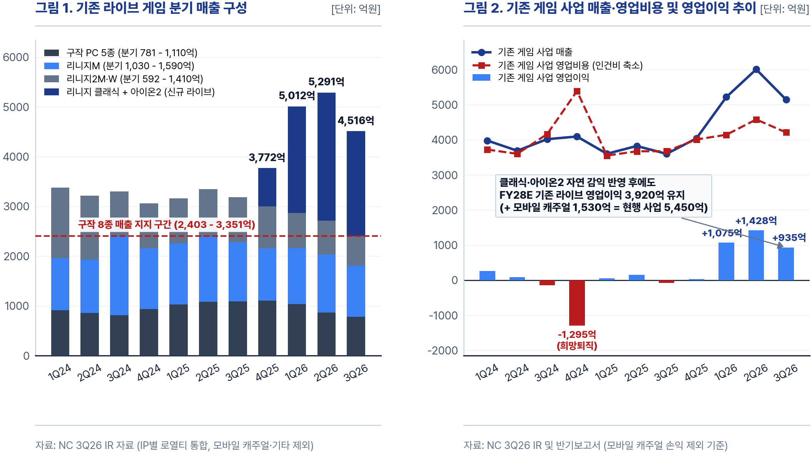
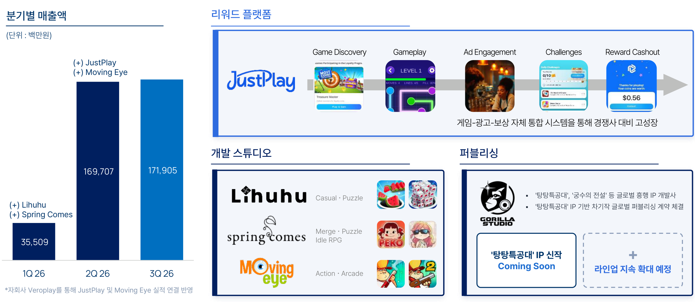
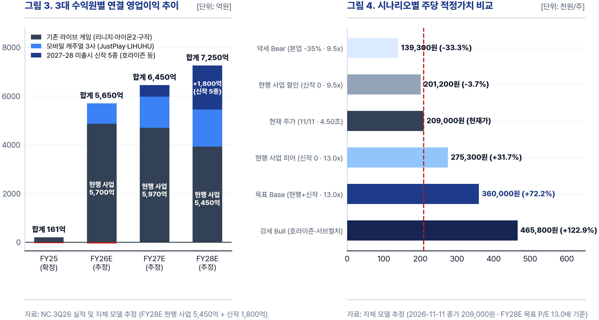
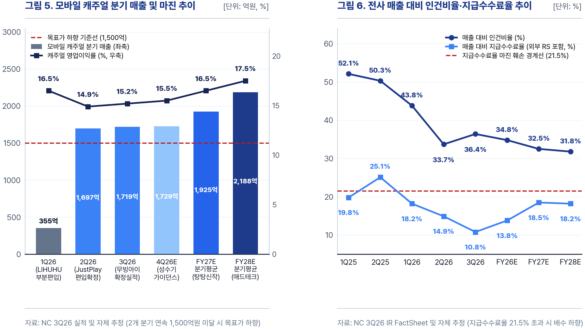

| 현재주가 (2026-11-11) | 시가총액 | FY27E P/E | FY28E P/E | 적정가치 (FY28E 13.0x) | 괴리율 |
| :---: | :---: | :---: | :---: | :---: | :---: |
| 209,000원 | 4조 5,027억원 | 8.3x | 7.5x | 360,000원 | +72.2% |

*연간 손익계산서 (단위: 억원, 원, % / 결산월: 12월)*

| 지표 (억원) | FY2022 | FY2023 | FY2024 | FY2025 | FY2026E | FY2027E | FY2028E |
| :--- | :---: | :---: | :---: | :---: | :---: | :---: | :---: |
| 매출액 | 25,718 | 17,798 | 15,781 | 15,069 | 28,200 | 33,000 | 35,200 |
| 매출 성장률 YoY (%) | - | -30.8% | -11.3% | -4.5% | +87.1% | +17.0% | +6.7% |
| 영업비용 | 20,128 | 16,425 | 16,873 | 14,908 | 22,550 | 26,550 | 27,950 |
| 영업이익 | 5,590 | 1,373 | -1,092 | 161 | 5,650 | 6,450 | 7,250 |
| 영업이익 YoY (%) | - | -75.4% | 적자전환 | 흑자전환 | N/M | +14.2% | +12.4% |
| 영업이익률 (%) | 21.7% | 7.7% | -6.9% | 1.1% | 20.0% | 19.5% | 20.6% |
| 당기순이익 (지배주주) | 4,357 | 2,121 | 942 | 3,467 | 4,150 | 5,450 | 5,966 |
| 희석 EPS (원) | 21,456 | 10,446 | 4,728 | 17,876 | 19,263 | 25,297 | 27,692 |
| 희석주식수 (가중평균, 천주) | 20,307 | 20,308 | 19,927 | 19,393 | 21,544 | 21,544 | 21,544 |
| PER (희석 기준, 배) | 20.9x | 23.0x | 38.7x | 11.3x | 10.8x | 8.3x | 7.5x |

*분기 손익계산서 (단위: 억원, 원, %)*

| 지표 (억원) | 3Q25 | 4Q25 | 1Q26 | 2Q26 | 3Q26 | 4Q26E | 1Q27E |
| :--- | :---: | :---: | :---: | :---: | :---: | :---: | :---: |
| 매출액 | 3,600 | 4,042 | 5,574 | 7,705 | 6,865 | 8,056 | 7,950 |
| 매출 성장률 YoY (%) | -10.4% | -1.3% | +54.7% | +101.5% | +90.7% | +99.3% | +42.6% |
| 매출 성장률 QoQ (%) | -5.9% | +12.3% | +37.9% | +38.2% | -10.9% | +17.3% | -1.3% |
| 영업비용 | 3,675 | 4,010 | 4,441 | 5,966 | 5,669 | 6,474 | 6,440 |
| 영업이익 | -75 | 32 | 1,133 | 1,739 | 1,196 | 1,582 | 1,510 |
| 영업이익 YoY (%) | 적자지속 | 흑자전환 | N/M | N/M | 흑자전환 | N/M | +33.3% |
| 영업이익률 (%) | -2.1% | 0.8% | 20.3% | 22.6% | 17.4% | 19.6% | 19.0% |
| 당기순이익 (지배주주) | 3,467 | -24 | 1,488 | 1,246 | 159 | 1,257 | 1,260 |
| 희석 EPS (원) | 17,878 | -110 | 7,672 | 6,407 | 737 | 5,835 | 5,848 |
| 희석주식수 (가중평균, 천주) | 19,392 | 21,544 | 19,393 | 19,454 | 21,544 | 21,544 | 21,544 |

---

## 결론

- 현재 주가 209,000원(시가총액 4.50조원)은 FY28E P/E 7.5배로 국내외 피어 평균 13.0배 대비 42% 할인 거래 중임.
- 현행 사업(기존 라이브 + 모바일 캐주얼) FY28E EPS 기준 P/E는 9.9배로, 미출시 신작 가치는 주가에 미반영 상태임.
- 3Q26 순현금 1조 6,544억원(시총의 36.7%)이 하방을 지지하며, 2027년 호라이즌 등 신작 5종이 이익 성장을 더함.
- FY28E EPS 27,692원에 적용 P/E 13.0배를 반영해 기준 적정가치 360,000원(+72.2%)을 산출하며, 12월 AGF와 내년 CBT로 점검함.

---

## 01. 회사 개요 및 수익 구조

### 1-1. 사업 구성과 수익 모델

- 3Q26 연결 매출 6,865억원은 PC 온라인 42.2%, 모바일 캐주얼 25.0%, 모바일 게임 23.6%로 다각화됨.
- 해외 및 로열티 매출 비중은 3Q26 기준 54%(북미·유럽 34%, 아시아 20%)로 서구권 노출도가 확대됨.
- 희망퇴직과 자체 PC 결제 확대로 3Q26 매출 대비 인건비율은 36.4%, 순수 지급수수료율은 10.8%로 낮아짐.
- 회사는 3Q26 공정공시를 통해 2026년 매출 가이던스를 2.8조원으로 높이고, 2027년 3.2조 - 3.4조원을 신규 제시함.

*3대 수익원 구성 및 실적 기여 (단위: 억원, %)*

| 수익원 구분 | 주요 타이틀 및 자회사 | 핵심 수익 모델 | FY25 매출 | 3Q26 매출 (비중) | 9M26 누적 매출 | FY28E 매출 (영업익) |
| :--- | :--- | :--- | :---: | :---: | :---: | :---: |
| 기존 라이브 (기타 포함) | 리니지군 5종, 아이온2, 구작 PC 4종 | 정액제 + 인앱 결제 + 배틀패스 | 15,069 | 5,146 (75.0%) | 16,373 | 18,000 (3,920) |
| 모바일 캐주얼 | JustPlay(독일), LIHUHU(베트남), 스프링컴즈·무빙아이 | 인앱 광고(IAA) + 하이브리드 캐주얼 | - | 1,719 (25.0%) | 3,771 | 8,750 (1,530) |
| 미출시 신작 5종 | 호라이즌, 아스트라 오라티오·브레이커스, 신더시티, 미스트바운드 등 | 비확률형 배틀패스 + 스킨·캐릭터 수집 | - | - (0.0%) | - | 8,450 (1,800) |
| 연결 합계 | 전사 3대 수익원 합산 | 코어 게임 + 애드테크 + 글로벌 신작 | 15,069 | 6,865 (100.0%) | 20,144 | 35,200 (7,250) |

---

## 02. 투자포인트

### 2-1. 기존 라이브 게임과 모바일 캐주얼 본업 체력

- 인력 구조조정과 분사를 거쳐 기존 게임 사업은 3Q26 매출 5,146억원, 영업이익 935억원을 기록하며 흑자 기조를 굳힘.
- 구작 8종 합산 매출은 3Q26 2,403억원(리니지M 1,030억원 포함)으로 분기 2,400억원 이상의 견고한 매출을 유지함.
- 월정액 기반 리니지 클래식은 3Q26 1,587억원(8개월 누적 4,530억원)을 기록해 분기 1,500억원대 캐시카우로 안착함.
- 아이온2 글로벌은 42일간 누적 결제액 1,103억원과 TL 대비 높은 과금 유저 잔존율을 기록해 4Q26부터 본격 반영됨.
- 모바일 캐주얼은 JustPlay MAU 2배 확대에 힘입어 3Q26 매출 1,719억원(비중 25.0%), 추정 영업이익 261억원을 기록함.
- 탕탕특공대 차기작 퍼블리싱과 4Q26 추가 M&A(가이던스 미반영 옵션)로 내년 전사 매출의 25 - 30% 기여를 목표함.
- 순현금 1조 6,544억원을 확보한 가운데 코어게임 M&A를 배제하고 FCF 기반 자사주 매입·배당 개편을 검토 중임.

### 2-2. 2027년 신작 파이프라인과 호라이즌 스틸 프론티어스

- 내부 테스트 D1 리텐션 90%를 넘긴 아스트라 오라티오가 1Q27 최선두로 출시되며 브레이커스·신더시티가 상반기 실적을 메움.
- 호라이즌 스틸 프론티어스는 소니 대표 IP(4,000만 장 판매) 기반 액션 RPG로 개발이 상당 부분 완료되어 출시 시기를 조율 중임.
- 원작 팬덤의 12%(480만 명) 유입과 초기 객단가 39달러 가정 시 출시 후 첫 12개월 총매출은 3,466억원으로 산출됨.
- 호라이즌 스틸 프론티어스 단독으로 FY28E 매출 2,800억원, 영업이익 +840억원(주당가치 +39,500원)을 기여할 전망임.
- 코어게임 마케팅비를 매출 대비 10% 이하로 통제하며, 본업 회복 후 신작이 더해질 때 피어 선행 P/E는 16배 이상으로 재평가됨.
- PS5 플랫폼 미포함에 따른 콘솔 유저 이탈, 서구권 비확률형 과금의 낮은 객단가, 외부 RS 수수료 상승은 주요 점검 요인임.

*호라이즌 스틸 프론티어스 출시 첫 12개월 P×Q 매출 산출 (단위: 만 명, 달러, 억원)*

| 구분 | 출시 초기 (1 - 30일) | 1분기차 (2 - 3개월) | 2분기차 (4 - 6개월) | 3분기차 (7 - 9개월) | 4분기차 (10 - 12개월) | 첫 12개월 합계 |
| :--- | :---: | :---: | :---: | :---: | :---: | :---: |
| 원작 대비 전환율 / 리텐션 | 원작 4,000만 장의 12% | 초기 유저의 35% | 1분기차의 70% | 2분기차의 80% | 3분기차의 85% | - |
| 활성 유저 수 (Q) | 480만 명 | 168만 명 | 118만 명 | 94만 명 | 80만 명 | 누적 480만 명 |
| 기간당 인당 결제액 (P) | 39달러 (약 5.3만원) | 16달러 / 분기 | 15달러 / 분기 | 14달러 / 분기 | 14달러 / 분기 | 연 환산 약 53달러 |
| 기간 총매출 (원화 환산) | 2,544억원 | 363억원 | 239억원 | 178억원 | 142억원 | 3,466억원 |

*국내외 주요 게임 피어 밸류에이션 및 재평가 선례 비교 (2026-11-11 기준)*

| 기업명 (티커) | 시가총액 | FY27E P/E | FY28E P/E | FY27E OPM | 시총 대비 순현금 | 핵심 이익원 및 재평가 이력 |
| :--- | :---: | :---: | :---: | :---: | :---: | :--- |
| 크래프톤 (259960) | 11.4조원 | 12.1x | 11.2x | 41.5% | 약 32% | 배그 트래픽 경신 + 신작 기대감으로 24년 P/E 11.5x에서 16.8x 확장 |
| 넷마블 (251270) | 4.6조원 | 14.2x | 12.8x | 12.4% | 순차입 | 비용 통제 + 2Q24 나혼렙 흥행(영업익 1,112억)으로 3개월간 주가 +42% |
| 넥슨 (3659 JP) | 2.4조엔 | 15.8x | 14.5x | 31.0% | 약 26% | 던전앤파이터·메이플스토리·FC 라이브 + 카잔 등 글로벌 신작 |
| 캡콤 (9697 JP) | 1.5조엔 | 14.5x | 13.5x | 36.5% | 약 18% | 몬스터헌터 와일즈·바이오하자드 등 글로벌 PC·콘솔 수렵 액션 표준 |
| 피어 4사 평균 | - | 14.2x | 13.0x | 30.4% | - | 글로벌 IP 보유 대형 게임사 평균 멀티플 |
| NC (036570) | 4.50조원 | 8.3x | 7.5x | 19.5% | 36.7% (금융자산 47.2%) | 리니지 클래식·아이온2 + 캐주얼 3사 + 호라이즌 등 신작 5종 |
| NC (현행 사업만) | 4.50조원 | 8.9x | 9.9x | 20.6% | 36.7% (금융자산 47.2%) | 기존 라이브(3,920억) + 모바일 캐주얼(1,530억), 미출시 신작 제외 |

---

## 03. 밸류에이션 및 시나리오

### 3-1. 적정가치 산출

- 현재 주가 209,000원은 현행 사업 FY28E 지배순이익 4,562억원(EPS 21,175원) 기준 P/E 9.9배로 신작 가치는 제외된 수준임.
- 현행 사업 적정가치 275,300원(13.0배)에 호라이즌과 기타 신작 4종 가치를 합산해 기준 적정가치 360,000원을 산출함.
- 외부 스튜디오 소수지분(장부가 568억원)은 0원으로 처리했으며, 약세 시나리오에서도 순현금 1조 6,544억원이 하방을 지지함.

*사업부별 가치 분해표 (FY28E 기준, 희석주식수 21.54백만주)*

| 가치 구성 요소 | FY28E 매출액 | FY28E 영업이익 | FY28E 지배순이익 | 주당 EPS | 적용 P/E | 주당 가치 (비중) |
| :--- | :---: | :---: | :---: | :---: | :---: | :---: |
| 1. 기존 라이브 게임 본업 | 18,000억원 | 3,920억원 (21.8%) | 3,492억원 | 16,209원 | 13.0x | 210,700원 (58.5%) |
| 2. 모바일 캐주얼 3사 (비지배 차감) | 8,750억원 | 1,530억원 (17.5%) | 1,070억원 | 4,966원 | 13.0x | 64,600원 (17.9%) |
| (소계) 현행 사업 합계 | 26,750억원 | 5,450억원 (20.4%) | 4,562억원 | 21,175원 | 13.0x | 275,300원 (76.5%) |
| 3. 호라이즌 스틸 프론티어스 | 2,800억원 | +840억원 (30.0%) | +655억원 | +3,041원 | 13.0x | +39,500원 (11.0%) |
| 4. 기타 미출시 신작 4종 | 5,650억원 | +960억원 (17.0%) | +749억원 | +3,476원 | 13.0x | +45,200원 (12.5%) |
| 5. 비상장 스튜디오 지분 (장부가 568억) | - | - | - | - | 0.0x | 0원 (0.0%) |
| 합계 (기준 적정가치 Base) | 35,200억원 | 7,250억원 (20.6%) | 5,966억원 | 27,692원 | 13.0x | 360,000원 (100.0%) |

*시나리오별 밸류에이션 요약 (현재 주가 209,000원 기준)*

| 시나리오 | 핵심 가정 (본업 + 신작 5종 + 적용 멀티플) | FY28E 영업이익 | FY28E 지배순이익 (EPS) | 적용 P/E | 적정가치 (괴리율) |
| :--- | :--- | :---: | :---: | :---: | :---: |
| 약세 (Bear) | 리니지·아이온2 급감 + 신작 5종 전면 부진(-300억) + 할인 배수 | 3,600억원 | 3,160억원 (14,668원) | 9.5x | 139,300원 (-33.3%) |
| 현행 사업만 (할인 / 피어) | 기존 라이브(3,920억) + 캐주얼(1,530억), 미출시 신작 가치 0원 | 5,450억원 | 4,562억원 (21,175원) | 9.5x / 13.0x | 201,200원 (-3.7%) / 275,300원 (+31.7%) |
| 기준 (Base) | 현행 사업(5,450억) + 호라이즌(+840억) + 기타 신작 4종(+960억) | 7,250억원 | 5,966억원 (27,692원) | 13.0x | 360,000원 (+72.2%) |
| 강세 (Bull) | 호라이즌 초기 흥행(650만명) + 서브컬처·탕탕 신작 안착 + 피어 배수 | 9,500억원 | 7,720억원 (35,834원) | 13.0x | 465,800원 (+122.9%) |

### 3-2. 중기 실적 및 핵심 지표 추정

- 2026년은 리니지 클래식과 아이온2 글로벌 온기 반영 및 캐주얼 편입으로 매출 2조 8,200억원, 영업이익 5,650억원을 기록할 전망임.
- 2027 - 2028년은 기존 라이브의 자연 감익을 모바일 캐주얼 성장과 신작 5종 가세가 상쇄하며 전사 영업이익 성장을 이어감.
- FnGuide 컨센서스 대비 자체 영업이익 추정치는 FY27E +2.9%, FY28E +4.6% 수준으로 회사 상향 가이던스와 부합함.

*3대 수익원별 중기 손익 추정 및 시장 컨센서스 비교 (단위: 억원, 원, %)*

| 구분 | FY25 | FY26E | FY27E | FY28E | 핵심 가정 및 컨센서스 대비 차이 |
| :--- | :---: | :---: | :---: | :---: | :--- |
| 기존 라이브 게임 매출 (영업익) | 15,069 (201) | 21,300 (4,860) | 19,500 (4,700) | 18,000 (3,920) | 구작 8종 연 1.0조원 지지 + 클래식·아이온2 완만한 하향 안정화 |
| 모바일 캐주얼 매출 (영업익) | - (-) | 6,900 (840) | 7,700 (1,270) | 8,750 (1,530) | 캐주얼 4사 온기 + 탕탕특공대 차기작 반영 (4Q 추가 M&A 미반영 보수 추정) |
| 미출시 신작 5종 매출 (영업익) | - (-40) | 0 (-50) | 5,800 (480) | 8,450 (1,800) | 1Q27 아스트라 오라티오·브레이커스 + 1H27 신더시티 + 4Q27 호라이즌 |
| 연결 매출액 (자체 추정) | 15,069 | 28,200 | 33,000 | 35,200 | FnGuide 컨센서스 대비 FY26E +1.3%, FY27E +2.8%, FY28E +3.8% |
| 연결 영업이익 (자체 추정) | 161 | 5,650 | 6,450 | 7,250 | FnGuide 컨센서스 대비 FY26E +2.7%, FY27E +2.9%, FY28E +4.6% |
| 지배주주순이익 (자체 추정) | 3,467 | 4,150 | 5,450 | 5,966 | FnGuide 컨센서스 대비 FY26E +1.7%, FY27E +3.2%, FY28E +4.5% |
| 희석 EPS (원, 자체 추정) | 17,876 | 19,263 | 25,297 | 27,692 | FnGuide 컨센서스(26E 18,938원 · 27E 24,508원 · 28E 26,504원) 상회 |

---

## 04. 주요 일정 및 리스크

### 4-1. 확인 일정 및 모니터링 지표

*향후 주요 확인 일정 및 모니터링 지표*

| 예정 시점 | 핵심 이벤트 | 확인 지표 및 판단 기준 |
| :--- | :--- | :--- |
| 2026년 12월 4일 - 6일 | AGF 2026 서브컬처 신작 출품 | 아스트라 오라티오(내부 D1 리텐션 90%+)·브레이커스 시연 반응 및 사전예약 속도 |
| 2027년 1분기 초 | 미디어·애널리스트 데이 및 정기주총 | 중장기 전략 공유, 소니 협의 후 호라이즌 출시일 발표, FCF 기반 주주환원 개편안 |
| 2027년 2월 (4Q26 실적) | 아이온2 글로벌 온기 반영 및 캐주얼 M&A | 아이온2 글로벌 결제액 매출 인식 규모 및 모바일 캐주얼 4Q 추가 M&A 조건 |
| 2027년 상반기 | 아스트라 오라티오·신더시티 등 연속 출시 | 1Q27 아스트라 오라티오 최선두 출시 및 1 - 2Q 매월 1 - 2종 신작(신더시티 등) 성과 |
| 2027년 4분기 | 호라이즌 스틸 프론티어스 글로벌 정식 출시 | 초기 30일 누적 이용자 480만 명 및 코어게임 마케팅비 매출 대비 10% 이하 준수 여부 |

### 4-2. 리스크 및 적정가치 하향 조건

- 모바일 캐주얼 분기 매출이 2개 분기 연속 1,500억원 미만이거나 영업이익률이 10% 이하로 하락할 경우 캐주얼 가치를 하향 조정함.
- 호라이즌 정식 출시가 2028년 하반기 이후로 지연되거나 CBT 후 스팀 위시리스트가 50위권 밖일 경우 기준 적정가치를 275,300원으로 조정함.
- 외부 퍼블리싱 확대로 전사 매출 대비 지급수수료율이 21.5%를 초과해 영업이익률이 15% 미만으로 하락할 경우 적용 배수를 9.5배로 조정함.

