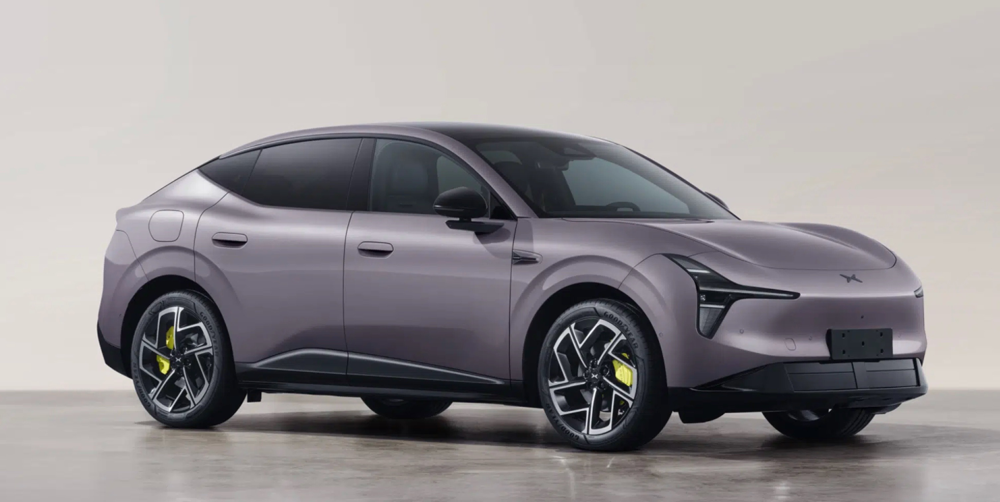
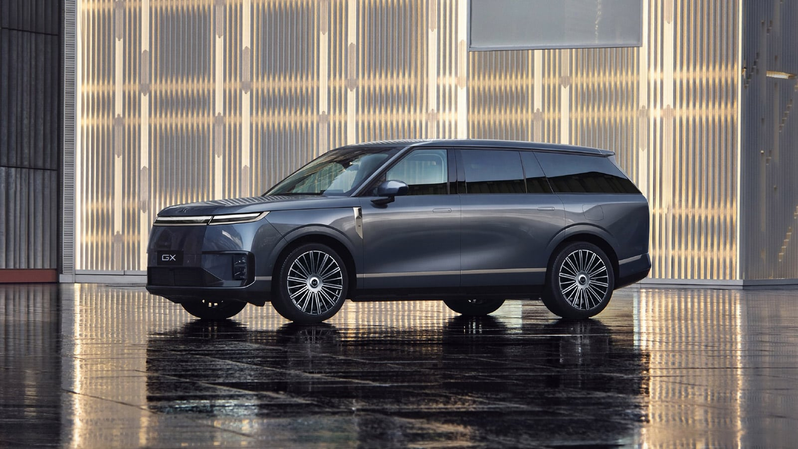
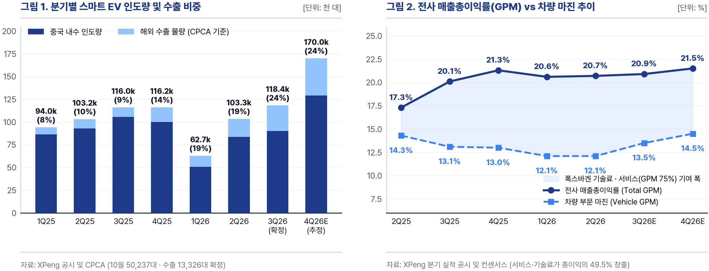
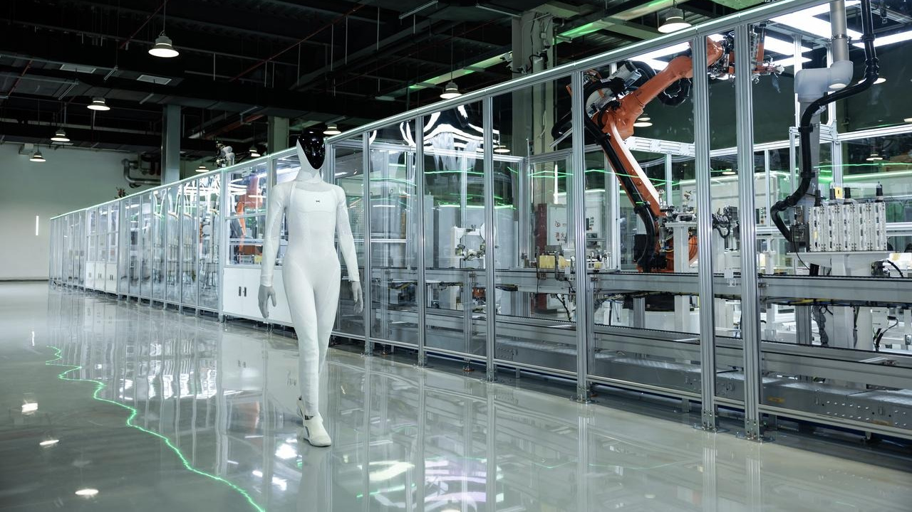
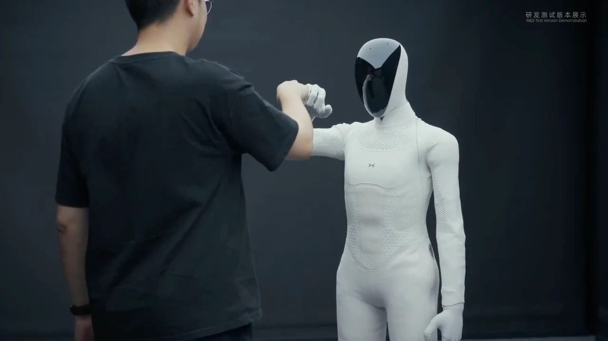
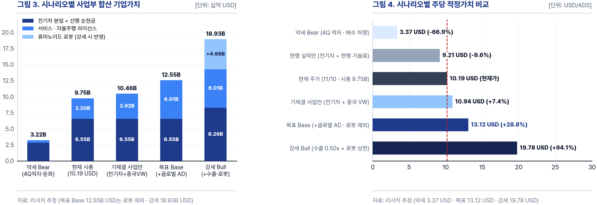
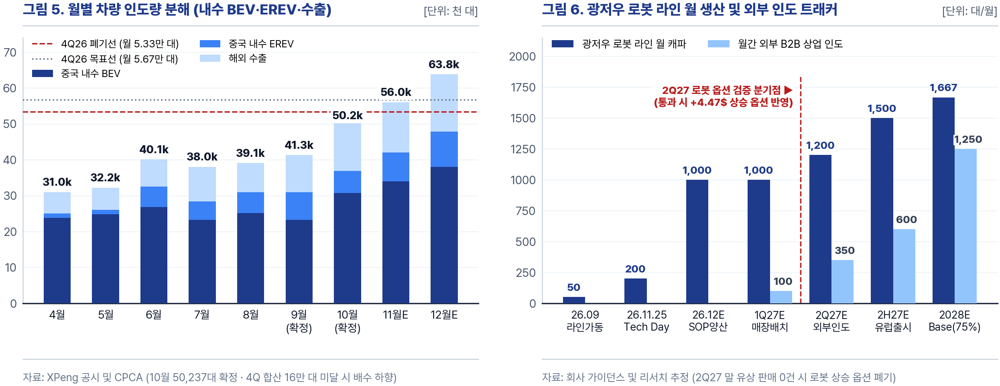

| 현재가 | 적정가치(Base) | 괴리율 | 시가총액 | 선행 EV/Sales | 핵심 모멘텀 |
| :---: | :---: | :---: | :---: | :---: | :---: |
| 10.19 USD (68.27 RMB) | 17.99 USD (강세 20.87) | +76.5% (강세 +104.8%) | 9.75B USD (65.32B RMB) | 0.57x (28E P/E 23.1x) | 11/16 실적 · 11/25 Tech Day |

| 단위: 십억 RMB | FY22 | FY23 | FY24 | FY25 | FY26E | FY27E | FY28E |
| :--- | :---: | :---: | :---: | :---: | :---: | :---: | :---: |
| 매출액 | 26.86 | 30.68 | 40.87 | 76.72 | 86.85 | 112.12 | 131.73 |
| YoY (%) | +28.0% | +14.2% | +33.2% | +87.7% | +13.2% | +29.1% | +17.5% |
| 매출총이익 | 3.09 | 0.45 | 5.85 | 14.47 | 18.25 | 23.55 | 29.64 |
| 총이익률 | 11.5% | 1.5% | 14.3% | 18.9% | 21.0% | 21.0% | 22.5% |
| 조정영업익 | -8.31 | -10.45 | -6.42 | -2.09 | -3.29 | 2.13 | 4.61 |
| 영업이익률 | -30.9% | -34.1% | -15.7% | -2.7% | -3.8% | 1.9% | 3.5% |
| 조정순이익 | -8.43 | -9.44 | -5.55 | -0.46 | -3.40 | 1.19 | 2.83 |
| GAAP순익 | -9.14 | -10.38 | -5.79 | -1.14 | -3.77 | 1.18 | 2.83 |
| 조정 EPS | -9.84 | -10.85 | -5.87 | -0.48 | -3.54 | 1.24 | 2.96 |
| 희석주식수 | 856.3 | 870.5 | 945.7 | 952.0 | 956.7 | 956.7 | 956.7 |
| PER (배) | N/A | N/A | N/A | N/A | N/A | 55.1 | 23.1 |

| 단위: 십억 RMB | 2Q25 | 3Q25 | 4Q25 | 1Q26 | 2Q26 | 3Q26E | 4Q26E |
| :--- | :---: | :---: | :---: | :---: | :---: | :---: | :---: |
| 매출액 | 18.27 | 20.38 | 22.25 | 13.03 | 19.74 | 23.57 | 30.51 |
| YoY (%) | +125.3% | +101.8% | +38.2% | -17.6% | +8.0% | +15.7% | +37.1% |
| QoQ (%) | +15.6% | +11.5% | +9.2% | -41.4% | +51.5% | +19.4% | +29.4% |
| 매출총이익 | 3.17 | 4.10 | 4.74 | 2.68 | 4.08 | 4.93 | 6.56 |
| 총이익률 | 17.3% | 20.1% | 21.3% | 20.6% | 20.7% | 20.9% | 21.5% |
| 조정영업익 | -0.84 | -0.52 | 0.18 | -1.78 | -1.04 | -0.85 | 0.38 |
| 영업이익률 | -4.6% | -2.6% | 0.8% | -13.6% | -5.3% | -3.6% | 1.2% |
| 조정순이익 | -0.39 | -0.15 | 0.50 | -1.69 | -1.24 | -0.86 | 0.39 |
| GAAP순익 | -0.48 | -0.38 | 0.38 | -1.78 | -1.34 | -0.95 | 0.30 |
| 조정 EPS | -0.41 | -0.16 | 0.52 | -1.76 | -1.29 | -0.90 | 0.41 |
| 희석주식수 | 951.2 | 952.7 | 967.4 | 955.3 | 956.4 | 956.7 | 956.7 |

- 표 기준 : FY22 - 2Q26은 공시 확정치이며 3Q26E - FY28E는 자체 모델 추정치임 (1 ADS = 보통주 2주, 기준 환율 1 USD = 6.70 RMB, 2026-11-10 기준가 10.19 USD, 주식수 백만 ADS)

## 결론

- 투자의견 : BUY 및 목표주가 17.99 USD(+76.5%) 제시, 로봇 양산 매출 시나리오 안착 시 강세 20.87 USD(+104.8%) 산출
- 현 주가 수준 : 현 주가는 전기차 본업과 폭스바겐 중국 로열티만 반영해 기투자받은 로봇 자회사 지분가치조차 미반영된 상태임
- 핵심 상방 근거 : 로봇 자회사 시리즈 A 실거래 지분가치 반영 위에 글로벌 완성차 자율주행 신규 공급 재평가를 결합함
- 확인 및 하향 조건 : 글로벌 수주와 로봇 외부 판매 지연 시 목표가를 하향하며, 4Q26 인도 16만 대 미달 시 매수 의견을 철회함

## 01. 회사 개요 및 수익 구조

### 1-1. 사업 구성과 이익 비중
- 2014년 설립된 샤오펑은 순수전기차(BEV)와 주행거리연장형(EREV)을 제조해 중국 내수와 해외 60개국에 판매하는 스마트 전기차 기업임
- 전사 매출의 86.3%는 차량 판매에서 나오나, 매출총이익의 절반(49.5%)은 부품·정비와 폭스바겐 기술료가 결합된 서비스 부문(총이익률 75.1%)에서 발생함
- 자체 설계 Turing AI 칩과 자율주행 소프트웨어(VLA 2.0)를 바탕으로 글로벌 완성차 기술 공급과 자회사 Dogotix(지분 73.97%) 로봇 양산을 추진 중임

| 볼륨 주력 신차 MONA L03 (10월 도매 20,637대) | 고마진 대형 SUV 신차 XPeng GX (EREV 비중 61.2%) |
| :---: | :---: |
|  |  |

| 단위: 십억 RMB  | 주요 제품 및 수익원                           | FY25 매출 |  2Q26 매출 (비중)  | 2Q26 총이익 (마진) |     향후 12개월 매출     |
| :---------- | :------------------------------------ | :-----: | :------------: | :-----------: | :----------------: |
| 스마트 EV      | 내수 전기차·EREV 및 해외 60개국 수출              |  68.38  | 17.05 (86.3%)  | 2.06 (12.1%)  |       96.30        |
| 서비스·기술 라이선스 | 부품·정비 + 폭스바겐 중국 로열티 + 글로벌 자율주행 공급     |  8.34   |  2.70 (13.7%)  | 2.02 (75.1%)  |   10.50 - 11.50    |
| 휴머노이드 로봇    | 자회사 Dogotix(지분 73.97%) 산업·상업용 로봇 IRON |  0.00   |  0.00 (양산 전)   |       -       | 28E 2.70 (강세 3.60) |
| 연결 합계       | 완성차 제조 + 고마진 기술 라이선스 결합               |  76.72  | 19.74 (100.0%) | 4.08 (20.7%)  |  106.80 - 107.80   |

## 02. 투자포인트

### 2-1. 전기차 턴어라운드
- 분기 인도량은 1Q26 비수기 저점(62,682대) 이후 2Q26 103,295대, 3Q26 118,390대로 반등함
  - 이어진 10월에는 단일 월 인도량 50,237대(+21.8% MoM)를 기록해 창사 이래 처음 월 5만 대를 넘어섬
- 보급형 세단 MONA L03(10월 도매 20,637대, 출고 대기 10주 이상)가 공장 가동률을 끌어올리며 고정비 부담을 낮춤
- 판매단가가 내수의 약 두 배(유럽 평균 4만 유로 이상)인 해외 수출이 10월 13,326대(비중 26.5%, +166% YoY)로 급증해 수익성 개선을 주도함
  - 오스트리아 마그나 슈타이어 공장에서 주력 4개 차종(G6·G9·P7+·G9L)을 현지 조립해 유럽연합의 중국산 전기차 고율 관세를 우회함
- 대형 주행거리연장형 SUV(GX·G9L, 10월 내수 6,251대) 물량이 더해지며 차량 총이익률은 2Q26 12.1%에서 4Q26E 14.5%로 상승할 전망임
- 다만 신차 출시 이후 구형 세단(M03·P7+) 판매 감소가 동반되어 신차 인도량 대비 전사 판매량 순증 비율은 41% 수준에 머묾
- 직영점 구조조정으로 판관비율은 FY23 21.4%에서 2Q26 11.9%로 낮췄으나, 자율주행·칩 연구개발비 비중(14.7%)이 높아 단기 영업이익률 상승폭은 제한적임
- 2Q26 말 보유 현금과 제한성예금 절반 합산액에서 총차입금(269억 RMB)을 차감한 순현금은 73.4억 RMB임
  - 손익분기점 도달 전 향후 12개월 예상 현금소진(20억 RMB)을 추가로 차감한 선행 순현금은 53.4억 RMB(8.0억 USD)임

### 2-2. 자율주행 솔루션 공급 확대
- 2024년 2월 전기 SUV 2종으로 시작한 폭스바겐 중국 기술 계약은 4차례 확장을 거쳐 중국 내 내연기관·플러그인 하이브리드 차종(연 270만 - 290만 대)까지 넓어짐
- 공동 플랫폼 설계를 통해 차내 전자제어장치(ECU) 수와 신차 개발 기간을 각각 30% 단축하며 글로벌 완성차 수준의 양산 품질을 검증받음
- 2Q26 서비스 매출 27.0억 RMB 중 약 37%(연간 35억 - 40억 RMB 규모)가 폭스바겐 기술료이며 부문 총이익률(75.1%)이 전사 이익을 방어함
- 오는 11/12 공동개발 신차(ID. ERA 5X) 출시를 기점으로 2027년부터는 개발비 정산 위에 대당 양산 로열티와 자체 Turing AI 칩 납품 매출이 유입됨
- 지난 10월 파리 오토모티브 서밋에서 자체 칩(Turing AI, 40코어·누적 20만 개 출하)과 자율주행 모델(VLA 2.0)을 외부 완성차에 파는 XPENG AI ENGINEERING을 출범함
  - 기존 전자 아키텍처 변경 없이 300억 파라미터 모델을 구동하는 외장형 AI BOX와 공장 출하 검사비를 95% 줄이는 툴체인을 모듈 단위로 공급함
- 후보 고객군 : 폭스바겐의 서구권 물량(연 600만 대 이상)은 미국 커넥티드카 규제로 리비안 합작사(RV Tech)가 전담하므로 수주 대상에서 제외됨
  - 실질 타깃은 파리 서밋 기조연설에 동석한 유럽 대중차(르노·스텔란티스 등)와 자체 소프트웨어 개발이 지연된 일본 완성차(도요타·닛산·혼다 계열)임
- 계약 1건 규모 : 폭스바겐 중국 단일 계약(연 35억 - 40억 RMB)을 감안할 때 중견 글로벌 완성차 1곳과의 초기 모듈 공급은 연 10억 RMB 매출 규모로 추산함
  - 부문 총이익률(75%) 적용 시 계약 1건당 연간 약 7.5억 RMB의 매출총이익이 추가되며 선행 부문 매출은 105억 RMB에서 115억 RMB로 늘어남
- 적용 배수 근거 : 선행 부문 매출 115억 RMB는 일반 부품·정비(약 50%)와 고마진 자율주행 기술료(약 50%)가 절반씩 결합된 구조임
  - 부품·정비에 완성차 배수(0.40배), 자율주행 기술료에 순수 자율주행 칩 피어인 호라이즌로보틱스 배수(6.60배)를 가중 평균해 3.50배를 적용함
  - 외부 추가 수주 없이 폭스바겐 중국 단일 고객에 머물 경우에는 서구권 전장 피어인 모빌아이(2.16배) 수준을 감안해 2.50배만 적용함

| 티커 (기업명) | 주력 사업 | 선행 배수 | 차기 매출 성장률 | 매출총이익률 | 현재 시장 평가 |
| :--- | :--- | :---: | :---: | :---: | :--- |
| 688836.SH (유니트리) | 범용 휴머노이드 · 사족보행 로봇 | P/S 40.8x | +60.2% | 60.1% | 순수 로봇 배수 |
| TSLA (테슬라) | 스마트 EV · FSD · 옵티머스 · ESS | EV/S 12.4x | +11.5% | 19.6% | 글로벌 피지컬 AI 선도 |
| 9660.HK (호라이즌) | 자율주행 AI 칩 · 주행보조 SW | EV/S 6.60x | +54.0% | 70.5% | 고마진 자율주행 칩 |
| MBLY (모빌아이) | 글로벌 레거시 ADAS 반도체 | EV/S 2.16x | +11.0% | 68.0% | 서구권 전장 부품 |
| XPEV (샤오펑) | 스마트 EV · 자율주행 · 로봇 | EV/S 0.57x | +29.1% | 20.7% | 완성차 배수 구간 |
| NIO (니오) | 중국 프리미엄 스마트 EV | EV/S 0.32x | +19.0% | 13.8% | 내수 중심 적자 EV |
| 9863.HK (립모터) | 중국 보급형 대중 EV | EV/S 0.16x | +30.3% | - | 보급형 대중 EV |

- 표 기준 : 2026-11-10 종가 및 향후 12개월(NTM) 컨센서스 기준임

| 선례 구분 | 주가가 움직인 사건 (날짜 · 공개 숫자) | 직전 주가 | 다음 날 | 12개월 후 | 선행 EV/S 변화 |
| :--- | :--- | :---: | :---: | :---: | :---: |
| 선례 1 (제휴 발표) | 2023-07-26 : 폭스바겐 7억 USD 지분 투자 · 플랫폼 제휴 | 15.36 USD | 19.46 USD (+26.7%) | 8.20 USD (-46.6%) | 2.1x → 3.2x 후 반납 |
| 선례 2 (실적 확인) | 2024-08-27 : M03 출시(52분 1만 대) + 기술료 GPM 60% 반영 | 7.51 USD | 8.00 USD (+6.5%) | 24.33 USD (+224.0%) | 0.8x → 2.4x 확장 |

- 선례 시사점 : 단순 양해각서나 제휴 발표만으로는 배수 확장이 유지되지 않았으며 실제 기술료 매출과 마진이 손익계산서에 찍힐 때 재평가가 지속됨

- 확인 시점 : 파리 모터쇼 자율주행 도로 시연에 이어 2027년 상반기 유럽 주행보조(NGP) 규제 승인과 첫 외부 완성차 본계약 공시 여부가 핵심 확인 지표임
- 경쟁 위험 : 현재 폭스바겐 중국 법인 외 외부 확정 고객은 0건이며 유럽 현지 주행 데이터 규제 통과에도 물리적 시간이 필요함
  - 중국 자율주행 경쟁사인 모멘타(6880.HK)가 이미 벤츠·GM·도요타·닛산의 도심형 주행보조 계약을 선점하고 있어 유럽·일본 수주전에서 직접 경쟁해야 함

### 2-3. 휴머노이드 로봇 양산
- 로봇 제조원가의 약 70%를 차지하는 관절 구동기와 손 부품 중 85%를 전기차 공급망과 공유해 소량 조립 스타트업 대비 양산 원가를 낮춤
- 지난 9월 광저우 전용 로봇 공장(연산 2만 대, 자동화율 80%)을 가동했고 10월 28일 전고체 배터리를 탑재한 양산형 IRON 시생산에 착수함
- 로봇 두뇌 역시 자체 설계 Turing AI 칩 3개(2,250 TOPS)와 차량용 자율주행 모델(VLA 2.0)을 그대로 탑재해 별도 소프트웨어 개발비를 절감함
- 8월 24일 공시된 자회사(Dogotix, 샤오펑 지분 73.97%) 시리즈 A에서 알리바바·텐센트·IDG 등 외부 기관이 6억 USD를 현금 출자해 기업가치 63억 USD를 인정함

| 광저우 전용 로봇 공장 자동화 라인 (자동화율 80%) | 22자유도 관절 손 · 엔지니어 실시간 교감 시연 |
| :---: | :---: |
|  |  |

- 목표 판매가 18만 RMB는 중국 소매업 연평균 임금(6.96만 RMB)의 2.6년분에 달해 단순 매장 안내·전시 용도로는 고객사의 투자비 회수 기간이 김
- 현재 샤오펑 자체 매장·공장 배치 외 외부 기업과의 확정 유상 수주는 0건이며 외부 투자금에는 7년 내 미상장 시 연 8% 복리 상환권이 붙어 있음
- 이에 기본 목표주가에는 외부 기관이 실제 현금을 납입한 시리즈 A 지분가치(46.6억 USD)만 반영하고, 2만 대 양산 매출 시나리오(57.0억 USD)는 강세에만 적용함

## 03. 밸류에이션 및 시나리오

### 3-1. 사업부 합산 적정주가 산출
- 현 주가 진단 : 현 주가 10.19 USD는 전기차 본업과 폭스바겐 중국 로열티만 반영한 수준으로 로봇 자회사 지분가치조차 빠져 있음
- 목표주가 동력 : 로봇 시리즈 A 투자유치 지분가치와 글로벌 자율주행 신규 공급 1건을 합산해 목표주가 17.99 USD(+76.5%)를 산출함
- 상·하방 범위 : 수출 확대와 로봇 2만 대 매출 시나리오 달성 시 강세 20.87 USD(+104.8%)이나 본업 적자 지속 시 약세 3.37 USD까지 하락함

| 사업 부문 | 선행 매출 · 기준 | 적용 배수 | 부문 가치 | 주당 가치 | 산출 근거 |
| :--- | :---: | :---: | :---: | :---: | :--- |
| 스마트 EV 본업 | 96.3B RMB | EV/S 0.40x | 5.75B USD | 6.01 USD | 니오(0.32x) 대비 수출 비중(26.5%) · 총이익률(20.7%) 우위 |
| 폭스바겐 중국 · 서비스 | 10.5B RMB | EV/S 2.50x | 3.92B USD | 4.10 USD | 부품·정비(0.40x) + 기체결 폭스바겐 양산 로열티 결합 |
| 글로벌 자율주행 확장 | +1.0B RMB | 부문 3.50x | +2.09B USD | +2.18 USD | 외부 완성차 1건 성사 시 부품(0.4x) · 호라이즌(6.6x) 가중 |
| 선행 순현금 | - | 1.00x | 0.80B USD | 0.83 USD | 2Q26 순현금(73.4억 RMB)에서 12개월 현금소진 차감 |
| 휴머노이드 로봇 (74%) | 시리즈 A 실거래 | 1.00x | 4.66B USD | 4.87 USD | 외부 기관 6억 USD 출자 포스트머니 63억 USD × 지분 73.97% |
| 목표주가 합계 (Base) | 107.8B RMB | SOTP 합산 | 17.21B USD | 17.99 USD | 기체결 본업(10.94) + 자율주행(+2.18) + 로봇 투자밸류(+4.87) |

| 시나리오 | 핵심 전제 | 차량 · 서비스 배수 | 기업가치 합계 | 적정주가 (괴리율) |
| :--- | :--- | :---: | :---: | :---: |
| 약세 (Bear) | 4Q26 적자 지속 · 중국 기술료 둔화 · 로봇 무산 | 0.16x · 0.32x | 3.22B USD | 3.37 USD (-66.9%) |
| 기체결 + 로봇밸류 | 전기차 흑자 + 폭스바겐 중국 + 로봇 투자유치 밸류 | 0.40x · 2.50x | 15.12B USD | 15.81 USD (+55.2%) |
| 목표 (Base) | 기체결 + 글로벌 자율주행 1건 + 로봇 투자유치 밸류 | 0.40x · 3.50x | 17.21B USD | 17.99 USD (+76.5%) |
| 강세 (Bull) | 수출 확대(0.50x) + 자율주행 + 로봇 2만 대 매출시나리오 | 0.50x · 3.50x | 19.97B USD | 20.87 USD (+104.8%) |

### 3-2. 중기 실적 추정
- 연결 손익은 4Q26 분기 흑자 전환 이후 폭스바겐 중국 양산 로열티 유입이 본격화되는 FY27E 조정순이익 11.9억 RMB로 연간 흑자 전환을 추정함
- 로봇 자회사(Dogotix)는 기본 목표주가에 시리즈 A 실거래 지분가치(46.6억 USD)로 반영하되, 강세 전환 조건인 양산 매출 시나리오를 별도 지표로 추적함

| 중기 실적 및 로봇 매출 시나리오 | FY25 | FY26E | FY27E | FY28E |
| :--- | :---: | :---: | :---: | :---: |
| 차량 매출액 (B RMB) | 68.38 | 77.35 | 101.62 | 119.73 |
| 서비스·기술 라이선스 연결 매출 (B RMB) | 8.34 | 9.50 | 10.50 | 12.00 |
| 전사 매출액 합계 (B RMB) | 76.72 | 86.85 | 112.12 | 131.73 |
| 전사 매출총이익률 (GPM) | 18.9% | 21.0% | 21.0% | 22.5% |
| 조정영업이익 (OPM) | -2.09 (-2.7%) | -3.29 (-3.8%) | 2.13 (1.9%) | 4.61 (3.5%) |
| 조정 EPS (RMB) | -0.48 | -3.54 | 1.24 | 2.96 |
| 로봇 출하 시나리오 (강세 풀가동 기준) | 0대 (-) | 0대 (-) | 5,000대 (25%) | 20,000대 (100%) |
| 로봇 지분가치 (Base 투자밸류 → Bull 매출) | - | 46.6억 USD | 0.90B RMB | 3.60B RMB (57.0억 USD) |

## 04. 주요 일정 및 리스크

### 4-1. 확인 일정 및 모니터링 지표
| 예상 시점 | 핵심 이벤트 | 정량 확인 기준선 | 주가 방향성 |
| :---: | :--- | :--- | :--- |
| 2026-11-12 | 폭스바겐 공동개발 ID. ERA 5X 출시 | 양산 출고 개시 및 2027년 대당 로열티 전환 일정 확인 | 기체결 로열티 확인 |
| 2026-11-16 | 3Q26 실적 발표 및 가이던스 | 4Q26 인도 가이던스 16만 - 17만 대 · 차량 총이익률 14%+ | 본업 배수(0.40x) 유지 |
| 2026-11-25 | XPeng Tech Day 개최 | 양산형 로봇(IRON) 현장 시연 · 단가 18만 RMB · 외부 수주 공개 | 로봇 밸류 정당화 · 강세 검증 |
| 2027년 상반기 | 글로벌 완성차 자율주행 본계약 | 유럽 NGP 규제 승인 및 유럽·일본 OEM 첫 모듈 공급 계약 | 목표가 유지 · 불발 시 하향 |

### 4-2. 리스크 및 적정가치 하향 조건
- 글로벌 자율주행 수주 및 로봇 상업화 지연 시
  - 리스크 요인 : 2027년 상반기까지 폭스바겐 외 글로벌 자율주행 신규 계약이 0건에 그치거나 2Q27 말까지 로봇 외부 유상 판매가 0건인 경우임
  - 가치 조정 : 글로벌 수주 불발 시 15.81 USD로, 로봇 상업화까지 동시 지연돼 투자밸류를 제외할 경우 기체결 본업 수준(10.94 USD)으로 기준 적정가치를 조정함
- 전기차 본업 턴어라운드 무산 시
  - 리스크 요인 : 4Q26 차량 인도량이 16만 대에 미달하고 분기 흑자 전환에 실패하거나 폭스바겐 기술료 매출이 2개 분기 연속 감소하는 경우임
  - 가치 조정 : 완성차 적용 배수(0.40배)의 전제가 훼손되므로 기준 적정가치를 약세 시나리오(3.37 USD) 수준으로 조정함

