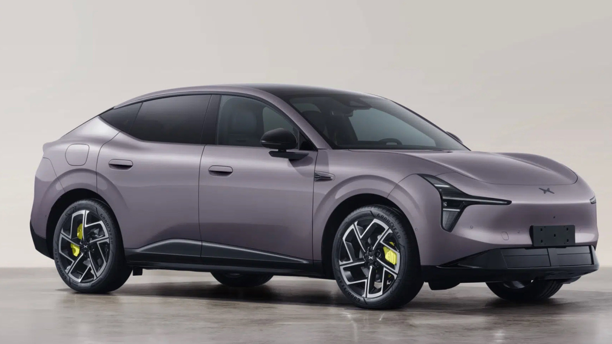
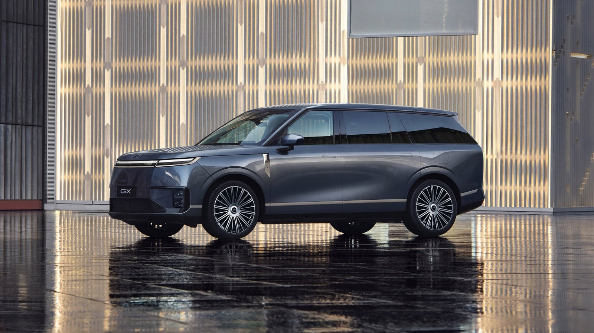
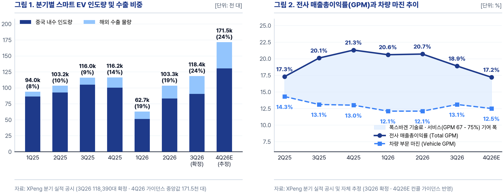
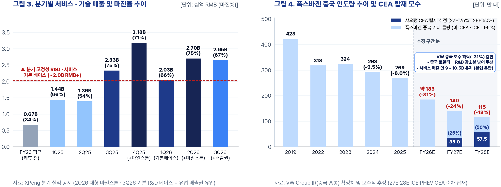
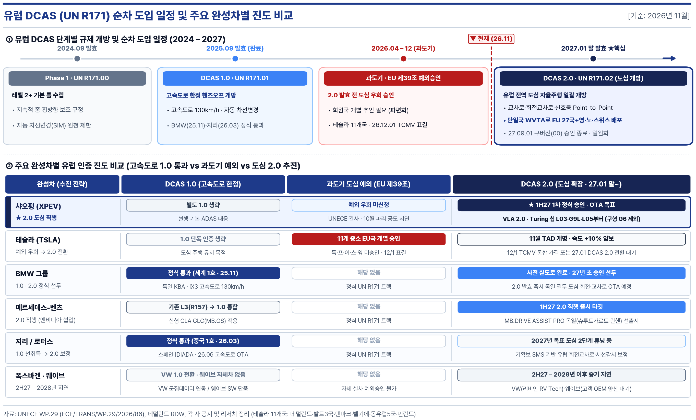
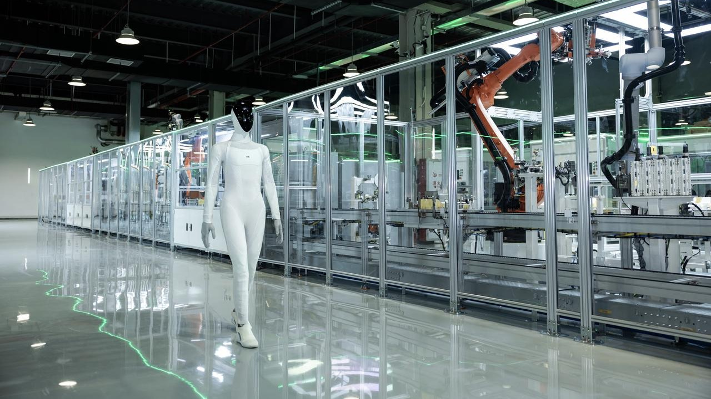
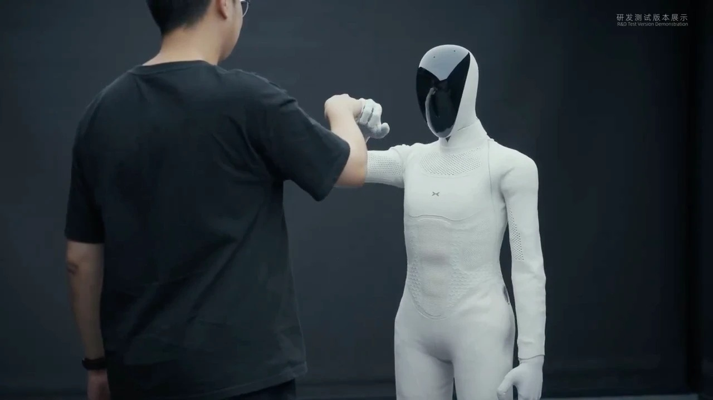
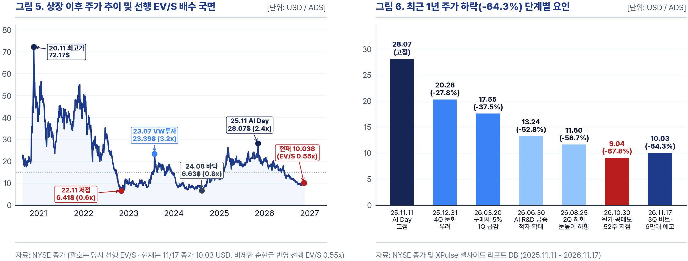
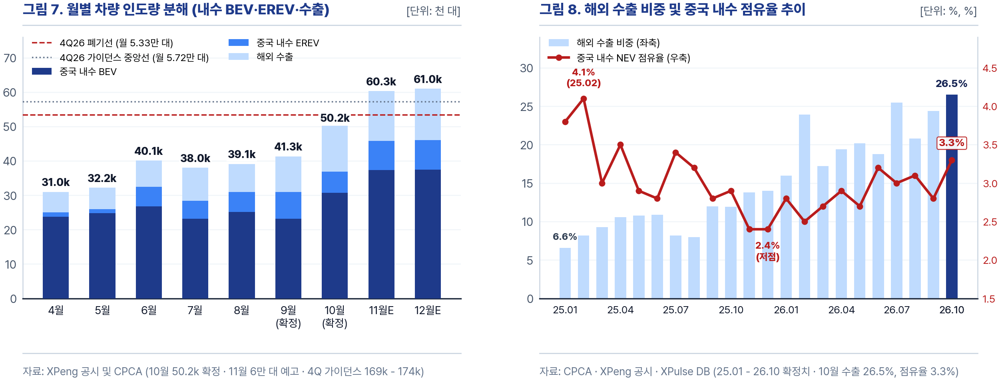

| 현재가 | 적정가치(Base) | 괴리율 | 시가총액 | 선행 배수 | 핵심 모멘텀 |
| :---: | :---: | :---: | :---: | :---: | :---: |
| 10.03 USD (66.90 RMB) | 15.04 USD (강세 19.54 USD) | +49.9% (강세 +94.9%) | 9.60B USD (64.04B RMB) | FY27E EV/S 0.54x (28E P/E 31.7x) | 11/25 AI Day · 11월 인도 6만 대 |

| 단위: 십억 RMB |  FY22  |  FY23  |  FY24  |  FY25  | FY26E  | FY27E  | FY28E  |
| :--------- | :----: | :----: | :----: | :----: | :----: | :----: | :----: |
| 매출액        | 26.86  | 30.68  | 40.87  | 76.72  | 88.15  | 108.20 | 124.35 |
| YoY (%)    | +28.0% | +14.2% | +33.2% | +87.7% | +14.9% | +22.7% | +14.9% |
| 매출총이익      |  3.09  |  0.45  |  5.85  | 14.47  | 16.70  | 19.74  | 23.27  |
| 총이익률       | 11.5%  |  1.5%  | 14.3%  | 18.9%  | 18.9%  | 18.2%  | 18.7%  |
| 조정영업익      | -8.31  | -10.45 | -6.42  | -2.09  | -4.05  | -0.76  |  1.97  |
| 영업이익률      | -30.9% | -34.1% | -15.7% | -2.7%  | -4.6%  | -0.7%  |  1.6%  |
| 조정순이익      | -8.43  | -9.44  | -5.55  | -0.46  | -4.20  | -0.56  |  2.02  |
| GAAP순익     | -9.14  | -10.38 | -5.79  | -1.14  | -4.52  | -1.16  |  1.42  |
| 조정 EPS     | -9.84  | -10.85 | -5.87  | -0.48  | -4.39  | -0.59  |  2.11  |
| 희석주식수      | 856.3  | 870.5  | 945.7  | 952.0  | 957.2  | 957.2  | 957.2  |
| PER (배)    |  N/A   |  N/A   |  N/A   |  N/A   |  N/A   |  N/A   | 31.7x  |

| 단위: 십억 RMB | 2Q25 | 3Q25 | 4Q25 | 1Q26 | 2Q26 | 3Q26 | 4Q26E |
| :--- | :---: | :---: | :---: | :---: | :---: | :---: | :---: |
| 매출액 | 18.27 | 20.38 | 22.25 | 13.03 | 19.74 | 24.28 | 31.10 |
| YoY (%) | +125.3% | +101.8% | +38.2% | -17.6% | +8.0% | +19.1% | +39.8% |
| QoQ (%) | +15.6% | +11.5% | +9.2% | -41.4% | +51.5% | +23.0% | +28.1% |
| 매출총이익 | 3.17 | 4.10 | 4.74 | 2.68 | 4.08 | 4.60 | 5.34 |
| 총이익률 | 17.3% | 20.1% | 21.3% | 20.6% | 20.7% | 18.9% | 17.2% |
| 조정영업익 | -0.84 | -0.52 | 0.18 | -1.78 | -1.04 | -0.77 | -0.46 |
| 영업이익률 | -4.6% | -2.6% | 0.8% | -13.6% | -5.3% | -3.2% | -1.5% |
| 조정순이익 | -0.39 | -0.15 | 0.50 | -1.69 | -1.24 | -0.89 | -0.38 |
| GAAP순익 | -0.48 | -0.38 | 0.38 | -1.78 | -1.34 | -0.87 | -0.53 |
| 조정 EPS | -0.41 | -0.16 | 0.52 | -1.76 | -1.29 | -0.93 | -0.40 |
| 희석주식수 | 951.2 | 952.7 | 967.4 | 955.3 | 956.4 | 957.2 | 957.2 |

- 표 기준 : FY22 - 3Q26은 공시 확정치, 4Q26E - FY28E는 내수 유지(36만→38만 대)·수출 2배(20만→25만 대)·중국 라이선스 플랫(외부 라이선스아웃 0)과 수출환급세·원가 역풍을 반영한 바텀업 추정 (1 ADS = 2주 · 환율 6.67 RMB · 11/17 종가 10.03 USD)

## 결론

- 적정가치 : 기준 적정가치 15.04 USD(+49.9%) 산출, 비중국 자율주행 수주와 로봇 양산 안착 시 강세 19.54 USD 도출
- 현 주가 수준 : 현 주가 10.03 USD는 내수 유지·수출 2배·중국 라이선스 플랫 본업 단독 가치(FY27E P/S 0.60x, 10.17 USD) 수준으로 피지컬 AI 옵션은 0원 반영 상태
- 적정가치 핵심 전제 : 본업(10.17 USD · 외부 라이선스아웃 0)에 기확정된 로봇 시리즈 A 실거래 지분(+4.87 USD)만 합산하고 비중국 자율주행·로봇 양산은 상방 옵션으로 분리
- 확인 및 조정 조건 : 11/25 AI Tech Day와 11월 월 6만 대 달성 확인 시 유지, 4Q 16만 대 미달·수출 마진 축소 및 로봇 상업화 지연 시 적정가치 하향

## 01. 회사 개요 및 수익 구조

### 1-1. 사업 구성과 수익 모델
- 순수전기차와 주행거리연장형 차량을 제조해 중국과 해외 60여 개국에 판매하며 자율주행·로봇을 결합한 사업 구조
  - 스마트 EV 부문(3Q26 매출 비중 89.1%) : 대중형 MONA와 주력 SUV 라인업을 중심으로 내수 및 해외 판매
  - 2026년 신차 라인업 : 대형 SUV GX 5월, 소형 SUV MONA L03 7월, G9L 9월, 대형 SUV MONA L05 10월 순차 투입
  - 서비스·기술 부문(매출 비중 10.9%) : 부품·정비·유럽 탄소배출권에 폭스바겐 기술 R&D 수익이 결합
  - 휴머노이드 로봇(Dogotix 지분 73.97%) : 자체 Turing AI 칩과 VLA 2.0을 공유하는 범용 로봇 IRON 양산 추진
- 완성차 제조와 고마진 기술료의 이중 마진 구조이며 대규모 AI 연구개발비가 단기 영업이익을 누르는 손익 구조
  - 3Q26 차량 마진은 13.1%이나 서비스·기술 마진이 67.1%에 달해 전사 매출총이익의 38.7%를 담당
  - 3Q26 연구개발비 2.85B RMB와 판관비 2.78B RMB를 합쳐 매출의 23.2%를 집행하면서 조정 영업이익률 -3.2% 기록
  - 기말 보유 현금성자산은 45.41B RMB로 총차입금 20.73B RMB를 웃도나 매입채무 35.86B RMB 운전자본 소요 존재

|      볼륨 주력 소형 SUV 신차 MONA L03 (10월 도매 20,637대)       |    고마진 대형 SUV 신차 XPeng GX (EREV 비중 61.2%)     |
| :--------------------------------------------------: | :-------------------------------------------: |
|  |  |

| 단위: 십억 RMB | 주요 제품 및 수익원 | FY25 매출 | 3Q26 매출 (비중) | 3Q26 총이익 (마진) | FY27E 매출 |
| :--- | :--- | :---: | :---: | :---: | :---: |
| 스마트 EV | 내수 전기차·EREV 및 해외 60여 개국 수출 | 68.38 | 21.63 (89.1%) | 2.83 (13.1%) | 98.20 |
| 서비스·기술 라이선스 | 부품·탄소배출권 + 폭스바겐 중국 기술료(외부 0) | 8.34 | 2.65 (10.9%) | 1.78 (67.1%) | 10.00 |
| 휴머노이드 로봇 | 자회사 Dogotix(지분 73.97%) 범용 로봇 IRON | 0.00 | 0.00 (양산 전) | - | 28E 3.60 (강세) |
| 연결 합계 | 완성차 제조와 고마진 기술료 결합 | 76.72 | 24.28 (100.0%) | 4.60 (18.9%) | 108.20 |

## 02. 투자포인트

### 2-1. 전기차 본업 턴어라운드
- 올해 중국 전기차 내수 시장이 첫 역성장 국면에 들어섰으나 샤오펑은 EREV와 수출로 점유율과 외형을 동시 반등
  - 중국 승용 NEV 소매는 구매세 부활로 1 - 10월 -12.9% 감소했으며 PHEV는 -37.2% 급락한 반면 EREV는 +1.0% 방어
  - 샤오펑 10월 글로벌 인도는 50,237대(+20.0% YoY)로 시장을 +33.5%p 상회하며 내수 점유율 3.3%로 상위권 재진입
- 하반기 SUV 신차 릴레이로 3분기 단가와 차량 마진이 반등했고 4분기 역대 최대 물량과 영업적자 추가 축소를 예고
  - 3Q26 매출은 24.28B RMB(+19.1% YoY)로 반등했고 대형 SUV GX 호조로 대당매출 18.27만 RMB와 차량 마진 13.1% 달성
  - 10월 말 출시한 MONA L05는 자율주행 상위 트림 선택률 98%를 기록하며 첫 달 1만 대 초과를 목표
  - 11월 창사 첫 월 6만 대 돌파를 예고했으며 4Q26 인도 16.9만 - 17.4만 대와 조정 영업손실 추가 축소(-0.46B RMB · OPM -1.5%) 전망

- 내수 가격 경쟁을 우회하는 고마진 해외 수출이 본업 수익성과 2027년 외형 성장의 핵심 축으로 부상
  - 4Q26 런레이트 기준 이미 연환산 16만 대+ 진입 : 10월 수출은 13,326대(+166% YoY · 비중 26.5%)로 사상 최고치를 경신하며 4Q26 분기 4만 대+(연환산 16만 대+) 및 연간 10만 대 돌파 궤도에 안착. 2027년 20만 대+(월 평균 1.67만 대) 목표는 상반기 저기저(월 3,200 - 7,500대) 대비 2배이나 4Q26 런레이트 대비로는 월 약 3천 대(+20%대) 추가 증분 구간
  - 신차 4종 온기 반영 및 EREV 해외 첫 투입 : 올해 상반기까지 구형 G6·G9에 84.6% 의존하던 수출 구조가 하반기 글로벌 신차로 교체 중(10월 MONA L03 4,074대로 G6 3,622대를 제치고 수출 1위 등극 · L05 유럽 초기 선적 1,019대 · G9L 12월 유럽 9개국 인도 · GX 중동 론칭). 올해 1분기 미만만 반영된 신차 4종의 2027년 온기 판매와 EREV 해외 투입이 핵심 증분 동력
  - 유통망 1,000개+ 확충 및 직영·현지조립 심화 : 해외 판매·서비스 거점을 올해 680개에서 내년 1,000개 이상으로 늘리고 영국·호주 직영 자회사 투자를 2배 강화하며, 오스트리아 마그나(4개 차종 현지생산)와 인도네시아·말레이시아 조립 거점을 심화해 EU 관세(30.7%) 및 내년 중국 수출환급세 축소(배터리 0% · 완성차 13% → 9%)에 대응 계획
  - 단기 분기 마진 흐름 : 현재 수출은 내수 대비 2배 이상 마진을 확보 중이나, L05 믹스와 서비스 비중 희석으로 4Q26 전사 총이익률은 17.2%(차량 12.5% 가정 · 연간 18.9%)로 단기 조정되며 영업현금 유입으로 기말 현금 45.41B RMB 확보

| 2027년 해외 권역 (목표 비중) | 목표 물량 (20만 대 기준) | 현재 트랙레코드 (26.1 - 10월 등록) | 2027년 핵심 증분 동력 |
| :--- | :---: | :--- | :--- |
| 유럽 (50%+) | 10만 대+ | 31개국 40,416대 (25년 연간 20,971대) | L03·G9L·L05 온기 · 영국 직영 100거점 · 마그나 4종 현지생산 |
| 동남아 · 아태 (~30%) | 약 6만 대 | 태국 5,443 · 인니 2,823 · 호주 월 620대 | 인니·말레이 현지조립 심화 · 호주 직영 확대 · 한국·일본 신규 진입 |
| 중동 · 중남미 (~20%) | 약 4만 대 | 이스라엘 5,937대 · 11/2 중동 11개국 론칭 | 중동·아프리카 20개국+(100거점) · 중남미 5개국(브라질 등) 진입 |

- 표 기준 : 권역별 비중은 3Q26 컨콜(브라이언 구 부회장) 가이던스, 국가별 등록대수는 XPulse 2026년 1 - 10월 공식 등록 집계 기준

| 중국 신흥 EV 4사   | 3Q26 인도량 | 3Q26 YoY | 26.1 - 10월 누적 | 핵심 차별화 및 수출 구조                   |
| :------------ | :------: | :------: | :-----------: | :------------------------------- |
| 샤오펑 (XPEV)    | 118,390대 |  +2.1%   |   334,604대    | 수출 비중 26.5% · EREV 신차 · 자체 칩·기술료 |
| 립모터 (9863.HK) | 310,052대 |  +78.3%  |  약 772,666대   | 스텔란티스 합작망 기반 대중형 볼륨 1위           |
| 니오 (NIO)      | 109,178대 |  +25.4%  |   334,547대    | 배터리 교체 인프라 · 내수 프리미엄 중심          |
| 리오토 (LI)      | 99,964대  |  +7.2%   |   322,461대    | 대형 패밀리 EREV 선두 · 해외 수출 미미        |

- 표 기준 : 각 사 분기 실적 공시 및 CPCA·XPulse 집계 기준

### 2-2. 자율주행 기술 사업 : 중국 로열티 가산과 해외 확장

- 서비스·기술 부문은 부품·배출권 베이스 위에 폭스바겐 반복 R&D와 양산 로열티가 얹히는 고마진 수익 구조
  - 3Q26은 2Q 대형 마일스톤 기저에도 기본 개발비와 유럽 탄소배출권 수익으로 매출 2.65B RMB와 마진 67.1% 방어
  - 올해 봄 출시된 폭스바겐 안후이 ID. UNYX 08과 11월 12일 상하이폭스바겐 ID. ERA 5X(CMP·CEA 첫 양산차)에 이어, 2027년부터 중국 내연기관(ICE)·PHEV 신차 및 부분변경 모델로 CEA 2.0 순차 확장
- 다만 폭스바겐 중국 판매의 약 95%(25년 약 257만 대 · BEV는 11.5만 대, 4.3%)가 Lavida·Sagitar·Passat·Magotan·Tiguan L 등 내연기관 위주여서 중국 내연기관 급랭에 정면 노출 중이며, 현재 급락 추세를 반영해 보수적 모수로 로열티를 추정할 필요
  - 폭스바겐 그룹 중국 인도량은 2019년 423만 대 고점 이후 하락세를 보이다 올해 1 - 9월 138만 대(-30.2% YoY · 2Q -36.6% · 3Q -38.5%)로 낙폭 심화, 연간 약 185만 대 추산 (2Q - 3Q 런레이트 이미 연환산 160만 - 165만 대)
  - 초기 공동개발 전기차 ID. UNYX 08 역시 4 - 8월 월평균 약 267대로 기대치를 하회해 가격 인하 및 FAW-VW 딜러망 위탁판매로 전환 중

| 폭스바겐 중국 인도량 | 2019 | 2023 | 2024 | 2025 | 9M26 | FY26E | FY27E (가정) | FY28E (가정) |
| :--- | :---: | :---: | :---: | :---: | :---: | :---: | :---: | :---: |
| 인도량 (만 대) | 423 | 324 | 293 | 269 | 137.9 | 약 185 | 140 | 115 |
| YoY (%) | - | +1.6% | -9.5% | -8.0% | -30.2% | 약 -31% | 약 -24% | 약 -18% |

- 표 기준 : VW Group IR 중국(홍콩 포함, 홍콩 비중 약 0.1 - 0.2%) 확정치 기준. 2026년 분기 추이는 1Q 54.9만(-14.8%) → 2Q 42.4만(-36.6%) → 3Q 40.6만(-38.5%), 10월 CPCA 소매는 FAW-VW 8.0만(-40.9%) · SAIC-VW 6.2만(-30%대)

- 현재 하락 추세를 반영해 폭스바겐 중국 모수를 FY27E 140만 대(-24%) · FY28E 115만 대(-18%)로 보수 가정하면, 중국 양산 로열티는 성장 엔진보다 기존 R&D 마일스톤 감소분을 메우는 마진 쿠션 역할
  - 계약 단가는 비공개(NDA)여서 글로벌 IB(CMBI·골드만·모닝스타) 역시 별도 멀티플이나 정교한 대당 로열티 분해 없이 서비스 매출을 연 9B - 10.5B RMB(GPM 60 - 65% 정상화) 방어 축으로 단순화해 본업에 통합 반영
  - 당사도 기준 적정가치에서 폭스바겐에 별도 고배수를 부여하지 않고 본업(P/S 0.60x)에 통합하되, 중국 모수 축소 시 중기 업사이드는 비중국(유럽·남미) 신규 수주가 결정하는 구조로 정리

- 서구권 자율주행 수출은 미국 원천 차단 속 유럽·남미 중심으로 이원화되며, 2027년 1월 말 유럽 DCAS 2.0 발효가 핵심 관문
  - 미국 vs 유럽 규제 경계 : 미국은 상무부 BIS 커넥티드카 규정(MY2027 중국 연계 ADS·VCS SW 금지 · MY2030 HW 금지)으로 진입이 원천 차단됐으나, 유럽은 국적 금지가 아니라 UNECE 형식승인(`UN R171·R155·R156`)·안전관리시스템(SMS)·GDPR 현지 데이터 처리 및 EU AI Act 검증 통과 시 판매·외판을 허용하는 체계
  - 유럽 순차 도입 구조 : 현재 도심 자율주행은 회원국별 예외승인(`EU 제39조`)이 필요해 테슬라(TAD)도 11개 중소국 개별 추인에 그친 상태이나, 2027년 1월 말 `DCAS 2.0(UN R171.02)` 발효 후에는 독일(KBA)·네덜란드(RDW)·스페인(IDIADA) 등 단일 체약국 1곳 형식승인(WVTA)만으로 EU 27개국과 영국·노르웨이·스위스에 일괄 판매·OTA 배포 가능

- 샤오펑은 UNECE 규칙 제정 참여와 자체 신차 기반 DCAS 2.0 직행 전략으로 비중국 B2B 수주를 추진 중이며, 실제 매출 확인 시 강세 리레이팅 옵션으로 분리
  - 유럽 실차 진도 및 HW 호환 경계 : UNECE `TF-ESRI` OICA 간사로 참여하고 10월 파리 모터쇼에서 테슬라와 유이하게 도심 일반도로 시연을 마쳐 1H27 `2.0` 1차 승인·OTA를 목표 (단, 도심 VLA 2.0은 750 TOPS+ 자체 Turing 칩이 필수라 구형 싱글 Orin-X 탑재 현행 유럽 G6는 제외되며, 10월 수출 1위로 올라선 MONA L03과 G9L·L05부터 적용)
  - 비중국 B2B 확장 및 경쟁 비교 : 10월 브라이언 구 부회장 직할 `XPENG AI Engineering`을 신설해 폭스바겐(10/28 CEO 남미·신흥국 CEA 적용 발표 · 10/29 CFO 유럽 역도입 평가 인정) 및 글로벌 OEM과 협의 중이며, 자체 차량이 없는 영국 웨이브(28년 OEM 양산 대기) 대비 'ECU 30% 원가 절감 + 1H27 자체 실차 인증' 패키지가 강점 (광저우 L4 시범 운영 승인을 받은 로보택시 YOYO도 2027년 경자산 수출 추진)
  - 보수적 밸류 처리 : EU의 대중국 커넥티드카 안보 심사 강화 가능성과 현재 비중국 확정 계약 0건이라는 점을 감안해 기준 적정가치(15.04 USD)에는 외부 라이선스아웃 매출 0원으로 미반영하고, 실제 계약·매출 가시화 시 본업 배수 상향(0.60x → 0.80x) 옵션으로 분리

### 2-3. 피지컬 AI 이벤트 및 휴머노이드 로봇 양산
- 11월 16일 3Q26 컨콜에서 내년 1월 대량 양산과 2분기 외부 상업 인도 타임라인 및 수익성 목표를 공식 재확인
  - 9월 광저우 자동화 라인(연 2만 대 · 핵심 공정 자동화율 80%+) 가동 및 핵심 부품사 정식 공급사 선정(Nomination) 완료에 이어, 2027년 1월 1일 대량 양산 → 1Q27 직영 매장 자율 응대 시범 배치 → 2Q27 외부 상업 고객 공식 인도 일정을 재확인
  - 허샤오펑 CEO가 수개월간 로봇 기술·조직을 직접 총괄하며 11월 25일 AI Tech Day·광저우 모터쇼에서 리모컨·사전 프로그래밍 없는 양산형 IRON 라이브 시연과 RSI 아키텍처 공개를 예고
  - 대기업 맞춤형 산업용이 아닌 커스터마이징이 필요 없는 표준화 범용 상품으로 중소 상업(SMB)·가정용(24시간 멀티 롤)을 1차 타깃으로 명확히 했으며, CEO·CFO 모두 IRON의 판매 잠재력과 총마진이 최고급 프리미엄 전기차를 유의미하게 상회할 것으로 제시
- 컨콜 Q&A에서 LLM 빅테크 진입에 맞선 피지컬 AI 4대 해자와 자동차 등급 품질·안전 장벽을 재강조
  - 양산형 IRON은 키 178cm, 전신 76자유도, 양손 각 21자유도 규격이며 자체 Turing AI 칩 3개와 VLA 2.0을 탑재하고 전기차 부품 협력사 85% 이상을 공유
  - 단일 범용 LLM(시스템 2)만으로는 물리 제어(시스템 0·1·2) 현장 배포가 어렵다며 물리 본체·자동차급 대량 양산·촉각/압력/온도 실세계 데이터·자체 칩 온디바이스 연산력의 4대 역량을 핵심 해자로 제시
  - 업계 로봇이 창고에 방치되는 원인을 안전성·품질 미달로 지목하고, 향후 2년 승부처를 자동차 등급 안전·품질 기준을 갖춘 대량 상업 배포로 규정

| 광저우 전용 로봇 공장 자동화 라인 (자동화율 80%+) | 21자유도 관절 손 · 엔지니어 실시간 교감 시연 |
| :---: | :---: |
|  |  |

- 자회사 Dogotix 시리즈 A 실거래 지분가치만 기준 적정가치에 반영하고 양산 매출은 강세로 분리
  - 8월 시리즈 A는 외부 기관 6억 USD(IDG·Gaorong·텐센트·알리바바)와 본사·경영진 3억 USD로 총 9억 USD 약정
  - 포스트머니 6.30B USD에 확정 지분율 73.97%를 곱한 4.66B USD(주당 4.87 USD)만 기준 적정가치 산입
  - 외부 유상 수주는 아직 전무하며 3Q 말 납입분 2.49B RMB 외 IDG 2차분 1.3억 USD 유입 예정
  - 우선주 상환권과 상업화 검증 과제를 감안해 연간 2만 대 양산 매출 가치(5.73B USD)는 강세로 분리

### 2-4. 왜 지금인가 : 멀티플 최저점과 4분기 턴어라운드 변곡점
- 최근 1년간 주가가 28.07 USD에서 10.03 USD(-64.3%)까지 하락한 것은 상반기 적자 재전환과 AI 투자 회의론이 겹친 결과
  - 올해 1분기 구매세 5% 부활 충격으로 인도량이 급감하며 상반기 조정 순손실 31.2억 RMB 적자로 재전환
  - 연간 110억 RMB를 웃도는 피지컬 AI 연구개발비가 당장 매출로 이어지지 못하자 기술 프리미엄 회수 및 공매도 19% 누적
- 절대 주가는 2024년 바닥보다 높으나 매출 외형이 3배 커져 선행 배수는 창사 이래 최저 구간
  - 2024년 8월 저점(6.63 USD) 당시 선행 EV/Sales는 0.80x였으나 현재 FY27E EV/Sales 0.54x(P/S 0.59x)는 역대 최저 수준
- 11월 말은 본업 볼륨 턴어라운드·적자 축소와 피지컬 AI 실물 검증이 동시에 겹치는 진입 변곡점
  - 10월 5만 대 돌파에 이어 11월 월 6만 대 예고, 4분기 역대 최대 매출(31.1B RMB)과 영업적자 축소·영업현금흐름 흑자 안착으로 상반기 적자 확대 우려 완화 국면
  - 지난해 11월 5일 AI Day IRON 공개 당시 일론 머스크가 X 검증 영상 좋아요와 iMessage 코멘트(*"Not bad. Tesla and China companies will dominate the market. Other companies in the West are weak"*)로 반응하며 주가가 6거래일 만에 21.79 USD에서 28.07 USD(+28.8%)로 급등한 선례 존재
  - 지난해 시연 후 당기 매출 부재로 상승분을 반납했으나, 이번 11월 25일 AI Tech Day는 내년 1월 양산 직전 실물 검증과 4분기 월 6만 대 볼륨 반등이 맞물리는 구간
  - 2024년 8월 MONA M03 출시와 폭스바겐 기술료 동반 인식 당시에도 주가가 12개월간 +224.0% 재평가된 선례 존재

## 03. 밸류에이션 및 시나리오

### 3-1. 적정가치 산출 및 피지컬 AI 옵션 계단
- 보수적 본업 가정(내수 유지 · 수출 2배 · 중국 라이선스 플랫 · 외부 라이선스아웃 0)에 피지컬 AI 옵션을 단계별로 얹는 직관적 계단식 SOTP로 산출
  - 현 주가 10.03 USD는 FY27E 본업 연결매출(108.20B RMB × P/S 0.60x = 10.17 USD, CMBI 0.6x 기준 동일) 단독 가치와 일치하며 **피지컬 AI(휴머노이드 로봇·비중국 AD·로보택시·플라잉카)가 전액 0원으로 할인된 상태**
  - 폭스바겐 중국 기술료는 내연기관 급감(-31%)과 단가 비공개(NDA)를 감안해 별도 고배수 없이 연 10.0B RMB 플랫 쿠션으로 통합했고, 미체결 비중국 라이선스아웃 매출은 0원으로 제외
  - 3Q26 회계 순현금은 24.68B RMB이나 매입채무 35.86B RMB, 분기 R&D, 로봇 납입금 2.49B RMB 중복 방지로 가산 제외
- 기준 적정가치 15.04 USD(+49.9%)는 본업 단독(10.17 USD)에 외부 기관이 실거래한 로봇 자회사 Dogotix 시리즈 A 지분가치(+4.87 USD)만 합산한 기준치
  - 로봇 시리즈 A를 절반(50%)만 인정해도 12.60 USD(+25.6%)가 도출되며, 기준 적정가치(15.04 USD)는 어닝 직후 셀사이드 통합 적정가치 평균(14.89 USD)·CMBI(15.00 USD)와 정합
  - 비중국 자율주행·로보택시 신규 수주(본업 0.80x, +3.39 USD → 18.43 USD)와 로봇 28E 2만 대 양산 확장(+1.12 USD 추가 → 19.54 USD)은 상방 옵션 계단으로 분리

| 가치 단계 (피지컬 AI 옵션 누적) | 본업 반영 | 피지컬 AI 옵션 반영 | 주당 가치 (USD) | 현 주가 대비 | 직관적 해석 |
| :--- | :---: | :--- | :---: | :---: | :--- |
| 0. 약세 (Bear) | 0.32x *(니오)* | 피지컬 AI 0% | 5.42 | -45.9% | 내수 잠식·수출 차질 + 신사업 무산 |
| 1. 본업 단독 (현 주가 수준) | 0.60x *(CMBI)* | 피지컬 AI 0% *(외부 AD 0)* | 10.17 | +1.4% | 현 주가(10.03 USD) = 피지컬 AI 무상 구간 |
| 2. + 로봇 옵션 50% 인정 | 0.60x | Dogotix 시리즈 A 50% (+2.43) | 12.60 | +25.6% | 외부 투자 밸류(6.3B)를 반값 할인해도 상방 |
| 3. + 로봇 시리즈 A 100% (Base) | 0.60x | Dogotix 시리즈 A 100% (+4.87) | **15.04** | **+49.9%** | 외부 라이선스 0원 전제 · 기준 적정가치 |
| 4. + 비중국 AD·로보택시 옵션 | 0.80x *(+0.20x)* | 시리즈 A + 해외 B2B/YOYO (+3.39) | 18.43 | +83.7% | DCAS 2.0·우버·해외 OEM 계약 가시화 시 |
| 5. + 로봇 28E 2만 대 양산 (Bull) | 0.80x | 28E 2만 대 양산 가치 (+1.12 추가) | **19.54** | **+94.9%** | 로봇 실매출 안착 시 상단 *(플라잉카 무상)* |

- 표 기준 : FY27E 본업 연결 매출 108.20B RMB = 차량 98.20B(내수 52.20B + 수출 46.00B) + 서비스·중국 VW 10.00B (1 USD = 6.67 RMB · 3Q26 희석 957.2M ADS · 순현금 미가산 · 로봇 시리즈 A 6.30B USD × 지분 73.97% = 4.66B USD)

| 티커 (기업명)         | 주력 사업 영역                  |   선행 배수    | 차기 성장률 | 매출총이익률 | 밸류에이션 비교 역할                 |
| :--------------- | :------------------------ | :--------: | :----: | :----: | :-------------------------- |
| 688836.SH (유니트리) | 범용 휴머노이드 · 사족보행 로봇        | P/S 40.8x  | +60.2% | 60.1%  | 순수 로봇 상단 (강세 로봇 18.0x 할인 기준) |
| TSLA (테슬라)       | 스마트 EV · FSD · 옵티머스 · ESS | EV/S 12.4x | +11.5% | 19.6%  | 자체 칩·VLA·로봇 결합 피지컬 AI 선도    |
| 9660.HK (호라이즌)   | 자율주행 AI 칩 · 주행보조 SW       | EV/S 6.60x | +54.0% | 70.5%  | 비중국 AD 수주 시 강세 리레이팅(0.80x) 참고 |
| MBLY (모빌아이)      | 글로벌 레거시 ADAS 반도체          | EV/S 2.16x | +11.0% | 68.0%  | 자율주행 기술료 마진(67%+) 비교 참고     |
| XPEV (샤오펑 전사)    | 스마트 EV · 자율주행 · 휴머노이드     | EV/S 0.54x | +22.7% | 18.9%  | 본업 단독(P/S 0.59x) 거래 구간      |
| NIO (니오)         | 중국 프리미엄 스마트 EV            | EV/S 0.32x | +19.0% | 13.8%  | 본업 약세 시나리오(0.32x) 하단 기준     |
| 9863.HK (립모터)    | 중국 보급형 대중 EV              | EV/S 0.16x | +30.3% |   -    | 저가 순수 완성차(비자동차 옵션 부재) 극단 하단 |

- 표 기준 : XPEV는 11/17 종가 10.03 USD · 비제한 순현금(5.1B RMB) 반영 FY27E EV/S 0.54x(P/S 0.59x) · 3Q26 GPM 18.9% · FY27E 성장률 기준, 피어는 향후 12개월(NTM) 컨센서스 기준

### 3-2. 핵심 드라이버 바텀업 추정 및 시나리오
- 본업 추정치는 ① 내수 유지(35.6만 → 36.0만 대), ② 수출 2배(10.0만 → 20.0만 대 · 단, MONA 믹스 및 환급세 4%p 인하를 반영해 수출 도매 ASP 25.4만 → 23.0만 RMB · 마진 20.5% → 18.0%로 하향), ③ 중국 라이선스·서비스 플랫(9.87B → 10.00B RMB), ④ 외부 라이선스아웃 0원 전제로 구축
  - 해외 도매 ASP와 마진은 1H26 반기보고서 실제 해외 매출(8.23B ÷ 3.16만 대 = 26.0만 RMB)과 CFO '수출 마진 내수 2배+' 발언에서 역산했으며, 연 12B RMB급 피지컬 AI R&D를 전액 비용 처리해 FY27E 손익분기 근접(-0.76B RMB) → FY28E 흑자 전환(+1.97B RMB)으로 블룸버그 컨센서스(FY27E 매출 108.9B)와 정렬
  - 수출 1.5배 민감도 : 2027년 수출이 2배(20만 대)에 미달해 1.5배(15만 대)에 그칠 경우 FY27E 매출은 96.70B RMB(-10.6%)로 축소되며, 본업 단독(0.60x)은 9.09 USD(-9.4%), 로봇 50% 반영 시 11.52 USD, 100% 반영 시 13.96 USD 산출

| 바텀업 추정 (단위: 십억 RMB) | FY25 (확정) | FY26E | FY27E (기준) | FY28E | 가정 요약 |
| :--- | :---: | :---: | :---: | :---: | :--- |
| 중국 내수 인도량 (만 대) | 38.4 | 35.6 | 36.0 | 38.0 | 내수 역성장 감안, 26E 수준 유지 |
| × 내수 ASP (만 RMB) | 14.8 | 14.9 | 14.5 | 14.5 | MONA 비중 확대 반영 |
| = 내수 차량 매출 (마진) | 56.90 (11.2%) | 52.87 (8.9%) | 52.20 (9.5%) | 55.10 (10.5%) | 배터리세·메모리 원가 반영 |
| 해외 수출 인도량 (만 대) | 4.5 | 10.0 | 20.0 | 25.0 | 4Q26 연환산 16만 → 27E 2배 |
| × 수출 도매 ASP (만 RMB) | 25.5 | 25.4 | 23.0 | 23.5 | 1H26 실측 26.0만 → L03·L05 하향 |
| = 수출 차량 매출 (마진) | 11.48 (21.0%) | 25.41 (20.5%) | 46.00 (18.0%) | 58.75 (18.5%) | 환급세 4%p 축소·믹스 하향 반영 |
| (+) 중국 라이선스 · 서비스 (마진) | 8.34 (68.2%) | 9.87 (68.7%) | 10.00 (65.0%) | 10.50 (63.0%) | VW 중국 플랫 · 외부 라이선스 0 |
| (=) 전사 연결 매출액 | 76.72 | 88.15 | 108.20 | 124.35 | FY27E 블룸버그 컨센(108.9B) 정합 |
| (=) 전사 매출총이익 (GPM) | 14.47 (18.9%) | 16.70 (18.9%) | 19.74 (18.2%) | 23.27 (18.7%) | 차량 GP 13.24B + 서비스 GP 6.50B |
| (-) 조정 영업비용 (AI R&D 포함) | 16.56 (21.6%) | 20.75 (23.5%) | 20.50 (18.9%) | 21.30 (17.1%) | 연 12B급 피지컬 AI R&D 비용화 |
| (=) 조정 영업이익 (OPM) | -2.09 (-2.7%) | -4.05 (-4.6%) | -0.76 (-0.7%) | +1.97 (+1.6%) | 27E 손익분기 근접 → 28E 흑자 전환 |

- 기준 적정가치 (Base 15.04 USD · +49.9%) : 본업 바텀업(FY27E 108.2B × 0.60x = 10.17 USD, 외부 AD 0원) + 로봇 시리즈 A 실거래 지분가치(+4.87 USD) 합산
- 강세 시나리오 (Bull 19.54 USD · +94.9%) : 비중국 자율주행·로보택시 수주로 본업 0.80x(13.56 USD) 리레이팅 + 로봇 28E 2만 대 양산 가치(+5.98 USD) 반영
- 약세 시나리오 (Bear 5.42 USD · -45.9%) : 내수 잠식·수출 마진 축소로 본업 니오 배수(0.32x) 할인 및 피지컬 AI 옵션 무산(0 USD) 가정

## 04. 주요 일정 및 리스크

### 4-1. 확인 일정 및 모니터링 지표
|     예상 시점     | 핵심 이벤트                           | 정량 확인 기준선                                | 주가 방향성                    |
| :-----------: | :------------------------------- | :--------------------------------------- | :------------------------ |
|  2026-11-25   | XPeng AI Tech Day · 광저우 모터쇼      | 리모컨 없는 IRON 라이브 시연 · 단가 공개 · RSI 아키텍처    | 로봇 밸류 정당화 모멘텀             |
|  2026-12-01   | 11월 차량 인도량 공시                    | 월 6만 대 첫 돌파 · MONA L05 첫 달 1만 대 초과 확인    | 4Q 가이던스(16.9만 - 17.4만) 신뢰 |
| 26.11 - 27.02 | Dogotix IDG 2차 투자금 납입            | 잔여 약정 1.3억 USD 완납 및 시리즈 A 총 6억 USD 유입 확인 | 자회사 자금 조달 확정              |
|  2027-01-01   | 광저우 로봇 라인 대량 양산 개시               | 1월 1일 양산 착수 및 1Q27 직영 매장 자율 응대 배치        | 상업 인도 전 램프업 검증            |
|   2027년 상반기   | EU DCAS 2.0 승인 · 비중국 OEM · 로봇 인도 | EU 1차 승인 · 글로벌 OEM 계약 1건 · 2Q27 외부 인도    | 적정가치 유지 · 불발 시 하향          |

### 4-2. 리스크 및 적정가치 하향 조건
- 중국 내수시장 구조적 역성장·출혈 경쟁 및 신차 자가잠식 심화
  - 내수 경쟁·과점화 : 구매세 5% 부활 이후 중국 NEV 내수 소매가 26.1 - 10월 887만 대(-12.9% YoY)로 첫 역성장 국면에 진입한 가운데, BYD(22.4%)·지리(11.8%)·립모터(7.5%) 등 상위 10사가 72.5%를 과점하고 샤오미(SU7·YU7)·화웨이 공세가 주력 12만 - 25만 RMB 세그먼트에 집중
  - 기존 차종 잠식 : 경쟁 격화로 1H26 기존 차종 판매가 -19% YoY 감소(M03 -28% · P7+ -51% · G9 -51%)하고 G7·신형 P7 볼륨 안착에 실패했으며, 신차 MONA L03 투입 때도 M03 잠식으로 브랜드 순증이 41%에 그쳐 L05·후속 신차에서도 자가잠식 재발 우려
- 중국 정부 4대 정책 변화와 해외 수출 2배 확대의 불확실성 · 마진 축소
  - 세제·보조금 역풍 : ① 내수 NEV 구매세 5% 과세(감면 한도 3만 → 1.5만 RMB 반감) 및 이구환신 비율제 전환(보급형 실질 혜택 축소), ② 리튬이온 배터리 소비세 단계 인상(26.09 2% → 27.09 4%), ③ 배터리 수출 VAT 환급 완전 폐지(27.01 0%), ④ 완성차(NEV) 수출 VAT 환급 인하(27.04 13% → 9% · 28년 일몰 가능성)에 차량용 DRAM 급등이 중첩
  - 수출 2배 불확실성 : FY27E 손익분기점 근접(-0.76B RMB) 및 FY28E 흑자 전환(+1.97B RMB)의 핵심 전제인 해외 수출 2배(10만 → 20만 대+)는 중국 전체 NEV 수출 폭증(26.1 - 10월 461만 대, +130%↑)에 따른 중국 브랜드 간 해외 가격경쟁 격화, EU 고율 관세(총 30.7%) 및 현지화(SKD) 반우회 심사, 1,000개 거점·현지조립 동시 확장 실행 부담으로 달성 불확실성 상존
  - 수출 마진 축소 가시성 : 완성차 환급 4%p 축소와 KD 우회에도 피할 수 없는 배터리 수출 환급 0% 폐지, 오스트리아·동남아 현지 조립 및 로컬 소싱 원가 상승, 고가 G6·G9에서 보급형 MONA(L03·L05)로의 수출 믹스 하향이 맞물려 현재의 '내수 대비 2배+' 수출 마진은 2027년 구조적 축소 불가피(바텀업 모델에 20.5% → 18.0% 하향 선반영)
  - 적정가치 조정 : 내수 잠식·수출 마진 축소로 4Q26 16만 대 미달 또는 2027년 차량 마진 훼손·흑자 전환 지연 시 본업 배수(0.60x)를 니오 수준(0.32x)으로 낮추며, 로봇 지연 동반 시 약세 5.42 USD로 하향
- 로봇 상업화 지연·폭스바겐 중국 모수 둔화 및 비중국 자율주행 수주 무산 시
  - 리스크 요인 : 2Q27 휴머노이드 IRON 외부 상업 인도 지연, 폭스바겐 중국 판매 급감(-30%대) 지속에 따른 서비스 마진 쿠션 약화, 혹은 1H27 비중국 완성차 신규 계약 무산
  - 적정가치 조정 : 로봇 상업화 지연 시 시리즈 A 지분가치(4.87 USD)를 제외해 본업 단독 가치(10.17 USD)로 하향하며, 비중국 자율주행 무산 시 강세 리레이팅(0.80x) 전제 철회
- 로봇 자회사 우선주 상환권·경영진 워런트 희석 및 공매도 수급 부담
  - 지배구조·부채 성격 : 외부 6억 USD 우선주는 7년 미상장 시 연 8% 복리 또는 원금 120% 상환권 존재
  - 추가 희석·수급 : 경영진 5억 USD 워런트 행사 시 샤오펑 지분은 68.41%로 희석되며 자유유통주식 공매도 19%로 변동성 상존

